# Hierarchical & Grouped Forecasting

Modified

November 18, 2026

Code

``` r
library(plotly) #<1>
```

1.  For the interactive 3D geometry plot.

# 1 Forecast Structures

Real-world data rarely comes as a single series. Sales, tourism demand, energy consumption, and public health metrics are all naturally organized into hierarchies or groups. Forecasting these structures naively — one series at a time — leads to numbers that don’t add up.

Three structures to understand before forecasting them properly: **hierarchical**, **grouped**, and **mixed**.

## 1.1 A Simulated Sales Dataset

To see the three structures on data small enough to draw, we simulate eight years of monthly sales of a beverage distributor in Mexico: 2 states × 2 cities, 3 products, and 2 sales channels.

Code

``` r
set.seed(2026)

# Calendar: 96 months, plus a national shock shared by every series.
# The shared AR(1) shock is what makes all series positively correlated.
months <- tibble(month = yearmonth("2018 Jan") + 0:95) |>
  mutate(
    t = row_number() - 1,                        # 0, 1, ..., 95
    month_num = (t %% 12) + 1,                   # 1 = Jan, ..., 12 = Dec
    national_shock = as.numeric(arima.sim(list(ar = 0.6), n = 96, sd = 0.04))
  )

geography <- tribble(
  ~state,       ~city,         ~city_size,
  "Jalisco",    "Guadalajara", 1.0,
  "Jalisco",    "Zapopan",     0.7,
  "Nuevo León", "Monterrey",   1.1,
  "Nuevo León", "San Pedro",   0.5
)

products <- tribble(
  ~product,       ~base_level, ~peak_month,       # seasonal peak differs by product
  "Café",         100,         12,                # winter drink
  "Agua mineral",  80,          6,                # summer drink
  "Chocolate",     50,         12
)

channels <- tribble(
  ~channel, ~share, ~growth, ~season_amp,         # Online: smaller, faster growth,
  "Online", 0.35,   0.012,   0.30,                # stronger seasonality
  "Tienda", 0.65,   0.002,   0.15
)

# A city-level AR(1) shock: series in the same city move together.
city_shocks <- expand_grid(city = geography$city, t = 0:95) |>
  mutate(city_shock = as.numeric(arima.sim(list(ar = 0.5), n = n(), sd = 0.03)),
         .by = city)

sales_mx <- geography |>
  cross_join(products) |>
  cross_join(channels) |>
  cross_join(months) |>
  left_join(city_shocks, by = c("city", "t")) |>
  mutate(
    trend  = exp(growth * t),                                          # exponential growth
    season = 1 + season_amp * cos(2 * pi * (month_num - peak_month) / 12),
    noise  = exp(national_shock + city_shock + rnorm(n(), sd = 0.06)), # correlated + idiosyncratic
    sales  = city_size * base_level * share * trend * season * noise
  ) |>
  select(month, state, city, product, channel, sales) |>
  as_tsibble(index = month, key = c(state, city, product, channel))

sales_mx
```

------------------------------------------------------------------------

Code

``` r
sim_sales_p <- sales_mx |>
  as_tibble() |>
  summarise(sales = sum(sales), .by = c(month, product, channel)) |>
  ggplot(aes(x = month, y = sales, colour = channel)) +
  geom_line() +
  facet_wrap(~ product, scales = "free_y") +
  labs(title = "Simulated sales by product and channel",
       subtitle = "Different seasonal peaks by product, different growth by channel",
       x = NULL, y = "Sales", colour = "Channel")
```

[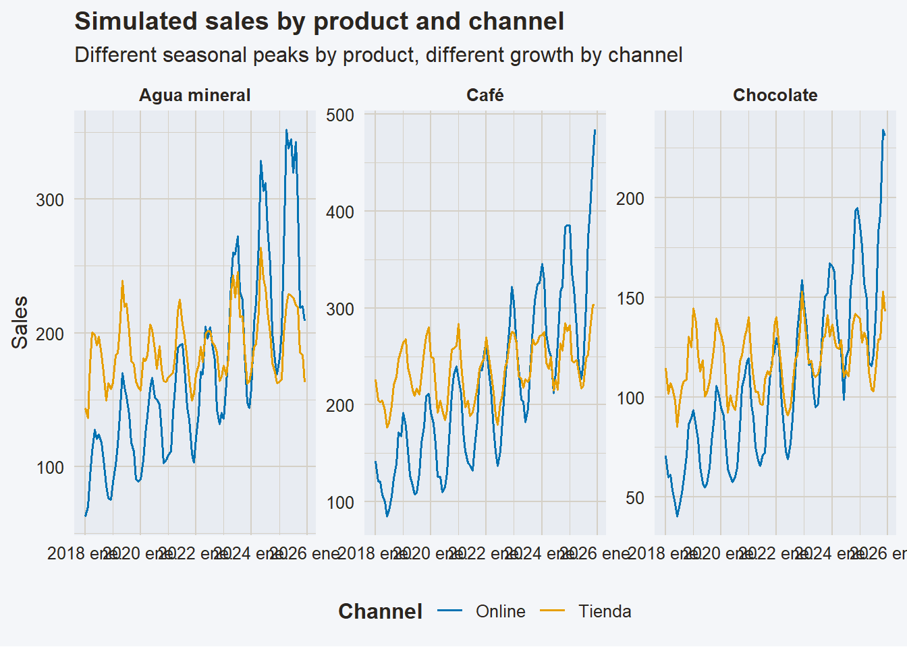](hierarchical_files/figure-html/sim-sales-plot-render-1.png)

[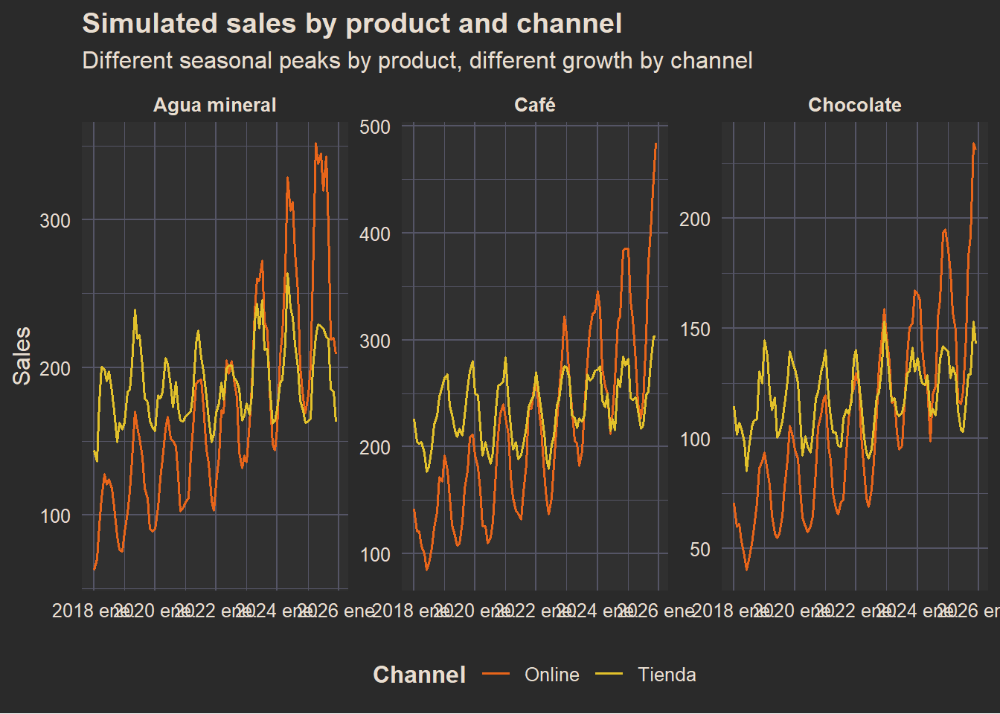](hierarchical_files/figure-html/sim-sales-plot-render-2.png)

## 1.2 Hierarchical Structures

In a **hierarchical** structure, every series at a lower level belongs to exactly one series at the level above. The structure is a unique tree.

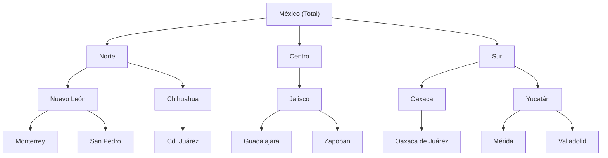

| Level  | Total | Region | State | City | **All series** |
|:-------|:-----:|:------:|:-----:|:----:|:--------------:|
| Series |   1   |   3    |   5   |  8   |     **17**     |

Only the 8 cities are observed directly (the **bottom level**); the other 9 series are sums of them.

## 1.3 Hierarchies in R: `/` Means “Nested In”

Our simulated data keeps two branches of that tree: Jalisco (Guadalajara, Zapopan) and Nuevo León (Monterrey, San Pedro).

Code

``` r
sales_hts <- sales_mx |>
  aggregate_key(state / city, sales = sum(sales)) #<1>

sales_hts |>
  as_tibble() |>
  distinct(state, city) #<2>
```

1.  `state / city` means *city is nested within state*. The sums over products and channels, the state totals, and the national total are computed and appended automatically.
2.  The keys of the result: one total, 2 states, 4 cities — $1 + 2 + 4 = 7$ series. Aggregated levels are marked `<aggregated>`.

## 1.4 Grouped Structures

In a **grouped** structure, the same series can be disaggregated by more than one attribute, and neither attribute nests inside the other. Sales can be split first by product and then by channel, or first by channel and then by product:

**Tree A**: Total → Product → Product × Channel

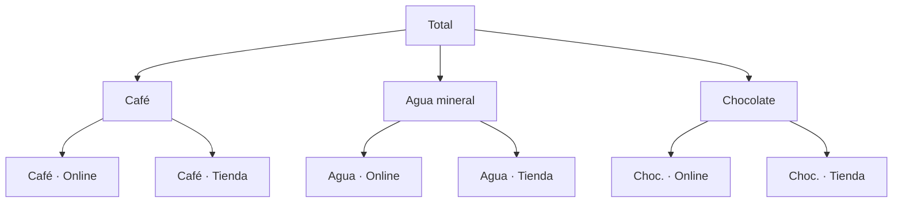

**Tree B**: Total → Channel → Channel × Product

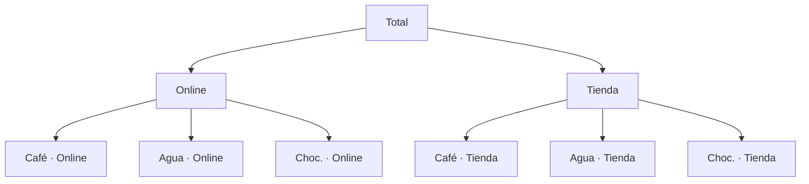

Both trees share the **same total** and the **same bottom level**; only the middle level differs.

## 1.5 Grouped = Two Trees Merged

Merging both trees gives a graph in which every bottom series has **two parents**: its product and its channel. That is why a grouped structure is not a hierarchy — there is no single tree.

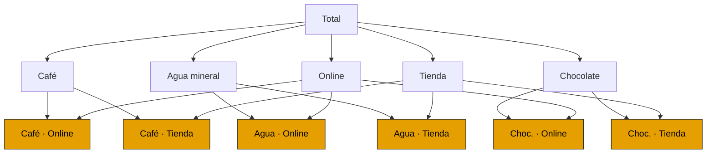

## 1.6 Grouped Structures in R: `*` Means “Crossed With”

Code

``` r
sales_grp <- sales_mx |>
  aggregate_key(product * channel, sales = sum(sales)) #<1>

sales_grp |>
  as_tibble() |>
  distinct(product, channel) #<2>
```

1.  `product * channel` crosses the two attributes: every product total, every channel total, every product × channel combination, and the grand total.
2.  Rows with exactly one `<aggregated>` key are the two middle levels — tree A’s product totals and tree B’s channel totals.

With $|P| = 3$ products and $|C| = 2$ channels, each attribute is either aggregated or takes one of its values:

$$(1 + |P|)(1 + |C|) = (1 + 3)(1 + 2) = 12 \text{ series}$$

## 1.7 Mixed Structures

A **mixed** structure combines both: the **hierarchical part** from [Hierarchical Structures](#sec-hier-structure) (state / city) × the **grouped part** from [Grouped Structures](#sec-grouped-structure) (product). The diagram shows the Jalisco branch; Nuevo León follows the same pattern.

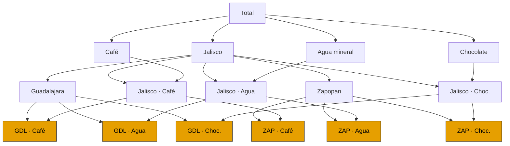

## 1.8 Mixed Structures in R

Code

``` r
sales_mixed <- sales_mx |>
  aggregate_key((state / city) * product, sales = sum(sales)) #<1>

sales_mixed |>
  as_tibble() |>
  distinct(state, city, product) #<2>
```

1.  The hierarchy `state / city` in parentheses, crossed with `product`.
2.  Every geographic node (total, state, or city) appears once with `product` aggregated and once per product.

The geographic part contributes $1 + |S| + |Ci|$ nodes, the grouped part $1 + |P|$:

$$(1 + |S| + |Ci|)(1 + |P|) = (1 + 2 + 4)(1 + 3) = 28 \text{ series}$$

# 2 Working with Hierarchical Data in R

For the modeling sections we switch to real data: `tourism` — quarterly domestic overnight trips in Australia by State, Region, and Purpose — the canonical example in FPP3 Chapter 11.

Code

``` r
tourism
```

## 2.1 `aggregate_key()` on `tourism`

Code

``` r
tourism_hts <- tourism |>
  aggregate_key(State / Region, Trips = sum(Trips)) #<1>

tourism_hts
```

1.  Region nested within State, summing over Purpose: $1 + 8 + 76 = 85$ series.

## 2.2 Visualizing Aggregated Series

`autoplot()` on an aggregated `tsibble` works as usual. Use `filter()` with `is_aggregated()` to select a specific level.

Code

``` numberSource
hts_state_plot_p <- tourism_hts |>
  filter(!is_aggregated(State), is_aggregated(Region)) |>
  autoplot(Trips) +
  facet_wrap(~ as.character(State), scales = "free_y", ncol = 4) +
  labs(title = "Domestic tourism trips by state", y = "Trips ('000)", x = NULL)
```

[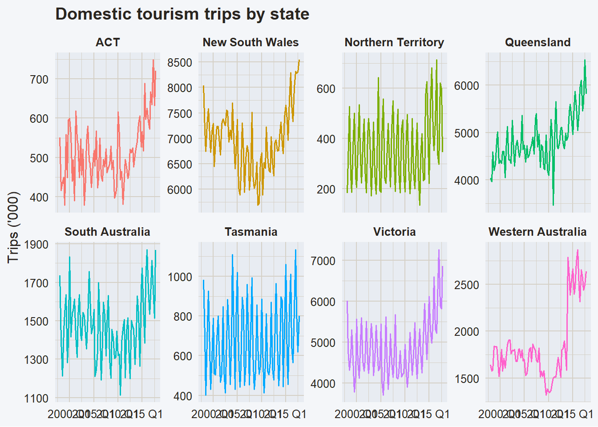](hierarchical_files/figure-html/hts-state-plot-render-1.png)

[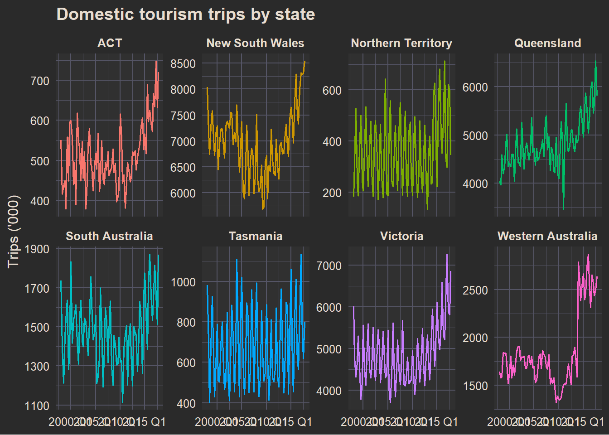](hierarchical_files/figure-html/hts-state-plot-render-2.png)

## 2.3 Filtering with `is_aggregated()`

`is_aggregated()` returns `TRUE` for the synthetic aggregation rows created by `aggregate_key()`. Use it inside `filter()` to navigate any level of the hierarchy.

## National Total

Code

``` r
tourism_hts |>
  filter(is_aggregated(State), is_aggregated(Region)) #<1>
```

1.  Both key columns are aggregated → single row per quarter.

## State Level

Code

``` r
tourism_hts |>
  filter(!is_aggregated(State), is_aggregated(Region)) #<1>
```

1.  State is specific but Region is still aggregated → one row per State per quarter.

## Region Level

Code

``` r
tourism_hts |>
  filter(!is_aggregated(State), !is_aggregated(Region)) #<1>
```

1.  Neither column is aggregated → most granular level.

# 3 Coherent Forecasts

> **IMPORTANT:**
>
> A set of forecasts is **coherent** if every aggregate-level forecast equals the sum of its component forecasts.
>
> If $\hat{y}_{NSW}$ and $\hat{y}_{VIC}$ are state-level forecasts, then the national forecast must satisfy $\hat{y}_{Total} = \hat{y}_{NSW} + \hat{y}_{VIC} + \cdots$

**Why does this matter?** If you give a retailer a national forecast of 1,000 units and regional forecasts that sum to 850, purchasing, logistics, and budgeting decisions made at different levels of the organization will not align.

## 3.1 Independent Forecasts Break Coherence

Fitting a model independently to every series — including the aggregated ones — almost never produces coherent forecasts. These independent forecasts are called **base forecasts**.

Code

``` r
tourism_train <- tourism_hts |>
  filter_index(. ~ "2015 Q4")

tourism_fit <- tourism_train |>
  model(base = ETS(Trips)) #<1>

tourism_base_fc <- tourism_fit |>
  forecast(h = "2 years")
```

1.  One ETS model per series: 85 models, each chosen independently by AICc.

------------------------------------------------------------------------

Code

``` r
incoherence <- tourism_base_fc |>
  as_tibble() |>
  mutate(source = case_when(
    is_aggregated(State)   ~ "total_fc",       # base forecast of the total
    !is_aggregated(Region) ~ "bottom_fc"       # base forecasts of the 76 regions
  )) |>
  filter(!is.na(source)) |>
  summarise(Trips = sum(.mean), .by = c(Quarter, source)) |>
  pivot_wider(names_from = source, values_from = Trips)

incoherence_p <- ggplot(incoherence, aes(x = Quarter)) +
  geom_line(data = tourism_hts |>
              filter(is_aggregated(State)) |>
              filter_index("2010 Q1" ~ .),
            aes(y = Trips)) +
  geom_ribbon(aes(ymin = pmin(total_fc, bottom_fc),
                  ymax = pmax(total_fc, bottom_fc)), alpha = 0.3) +
  geom_line(aes(y = total_fc, colour = "Base forecast of the total"),
            linewidth = 1) +
  geom_line(aes(y = bottom_fc, colour = "Sum of the 76 regional base forecasts"),
            linewidth = 1) +
  annotate("label", x = yearquarter("2017 Q1"),
           y = mean(c(incoherence$total_fc[5], incoherence$bottom_fc[5])),
           label = "incoherence gap", size = 3.5) +
  labs(title = "Base forecasts don't add up",
       subtitle = "Australian domestic trips: national total",
       x = NULL, y = "Trips ('000)", colour = NULL)
```

[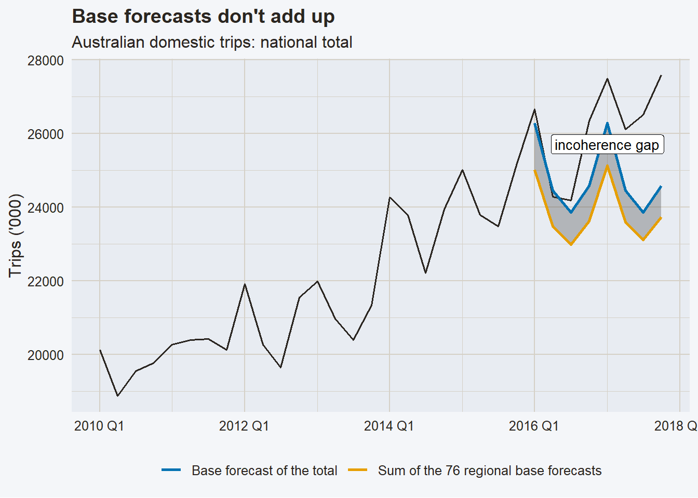](hierarchical_files/figure-html/incoherence-plot-render-1.png)

[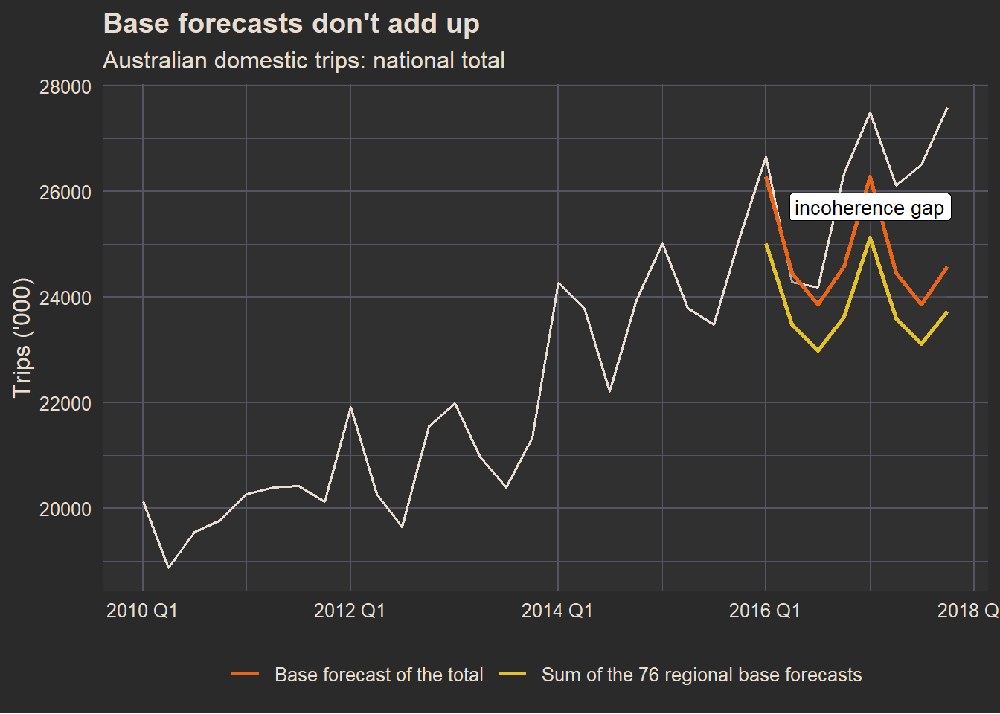](hierarchical_files/figure-html/incoherence-plot-render-2.png)

Two forecasts of the same quantity, and they disagree. Which one should the national planning team use? This is the incoherence problem that the rest of the document solves.

# 4 Single-Level Approaches

Single-level approaches fix the coherence problem by choosing **one level as the source of truth** and deriving all other levels from it.

All three share the same interface: `reconcile()` takes the fitted mable and wraps the base model with a reconciliation strategy. We look at each with the same template: which level is forecast, and what happens to the **total** and to one **bottom series** (Melbourne).

Code

``` r
tourism_single_fc <- tourism_fit |>
  reconcile(
    bu = bottom_up(base),               #<1>
    td = top_down(base),                #<2>
    mo = middle_out(base, split = 1)    #<3>
  ) |>
  forecast(h = "2 years")
```

1.  Bottom-up from the 76 regions.
2.  Top-down from the national total (default: `method = "forecast_proportions"`).
3.  Middle-out from the state level (`split = 1` = one level below the total).

------------------------------------------------------------------------

The plotting helper below is used, unchanged, for all three methods.

Code

``` r
plot_base_vs_rec <- function(fc, method, bottom = "Melbourne") {
  pick <- \(x) x |>
    filter(is_aggregated(State) | Region == bottom) |>
    as_tibble() |>
    mutate(series = if_else(is_aggregated(State), "Total (Australia)",
                            paste(bottom, "(bottom level)")),
           series = fct_relevel(series, "Total (Australia)"))

  history <- tourism_hts |>
    filter_index("2012 Q1" ~ .) |>
    pick()

  fc_tbl <- fc |>
    filter(.model %in% c("base", method)) |>
    pick() |>
    mutate(`95%` = hilo(Trips, 95),
           .model = factor(.model, levels = c("base", method))) |>
    unpack_hilo("95%")

  ggplot(fc_tbl, aes(x = Quarter)) +
    geom_line(data = history, aes(y = Trips)) +
    geom_ribbon(aes(ymin = `95%_lower`, ymax = `95%_upper`, fill = .model),
                alpha = 0.2) +
    geom_line(aes(y = .mean, colour = .model), linewidth = 0.9) +
    facet_wrap(~ series, scales = "free_y") +
    labs(x = NULL, y = "Trips ('000)", colour = "Forecast", fill = "Forecast")
}
```

## 4.1 Bottom-Up

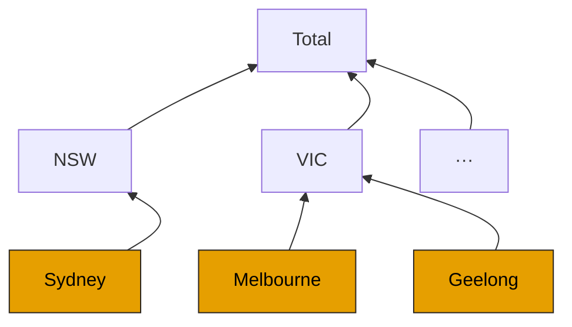

- Forecast only the **bottom level** (highlighted).
- Every aggregate is the **sum** of its bottom-level forecasts (arrows point up).
- Bottom-level forecasts are left untouched.

------------------------------------------------------------------------

Code

``` r
bu_p <- plot_base_vs_rec(tourism_single_fc, "bu") +
  labs(title = "Bottom-up: base vs. reconciled")
```

[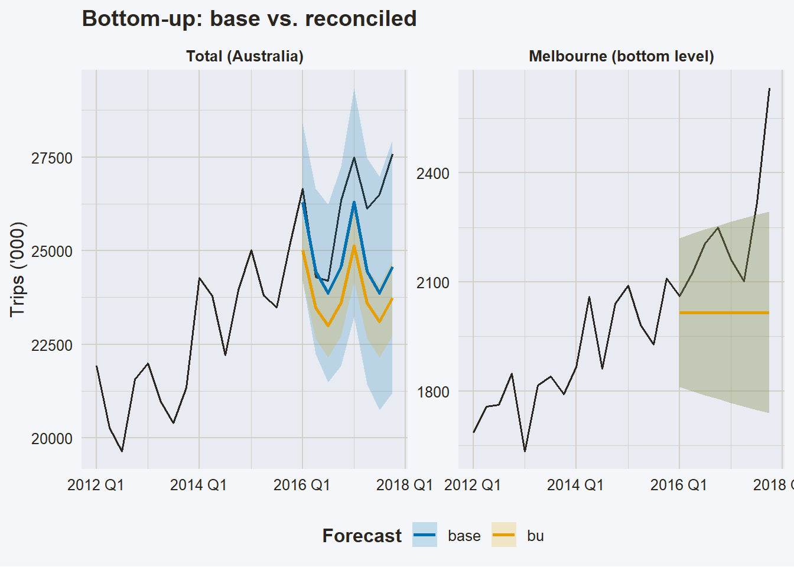](hierarchical_files/figure-html/bu-plot-render-1.png)

[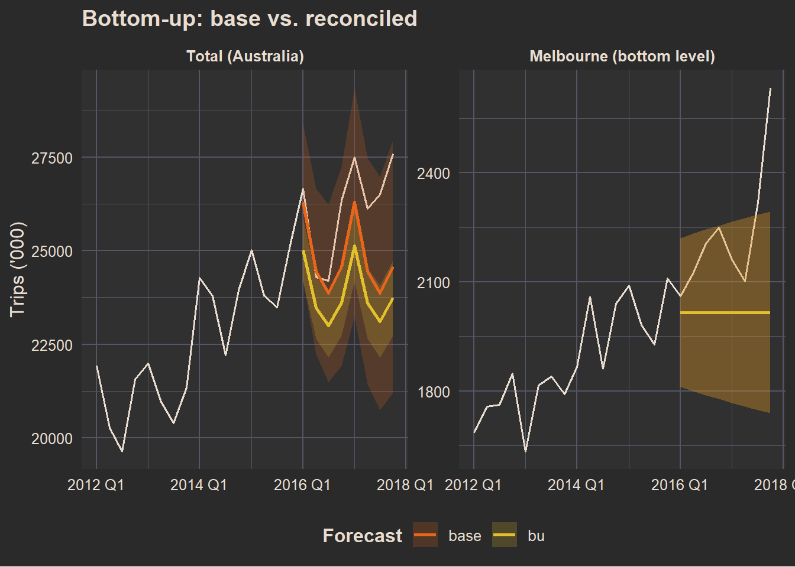](hierarchical_files/figure-html/bu-plot-render-2.png)

The Melbourne panel shows a single line: bottom-up does not change the bottom level. The total, however, moves to the sum of the 76 regional forecasts.

> **WARNING:**
>
> For 2016 Q1, the base ETS forecast of the total has a standard deviation of 1071 thousand trips; the bottom-up forecast has 429.
>
> For `bottom_up()`, `fabletools` treats every **covariance** between regions as zero, so the variance of the total is just the sum of the regional variances. Regional errors are positively correlated, so the true variance is larger: the bottom-up interval for the total is **too optimistic**. Several `min_trace()` methods share this problem — see [Weighting = Estimating](#weighting-estimating-w_h) $W_h$.

## 4.2 Top-Down

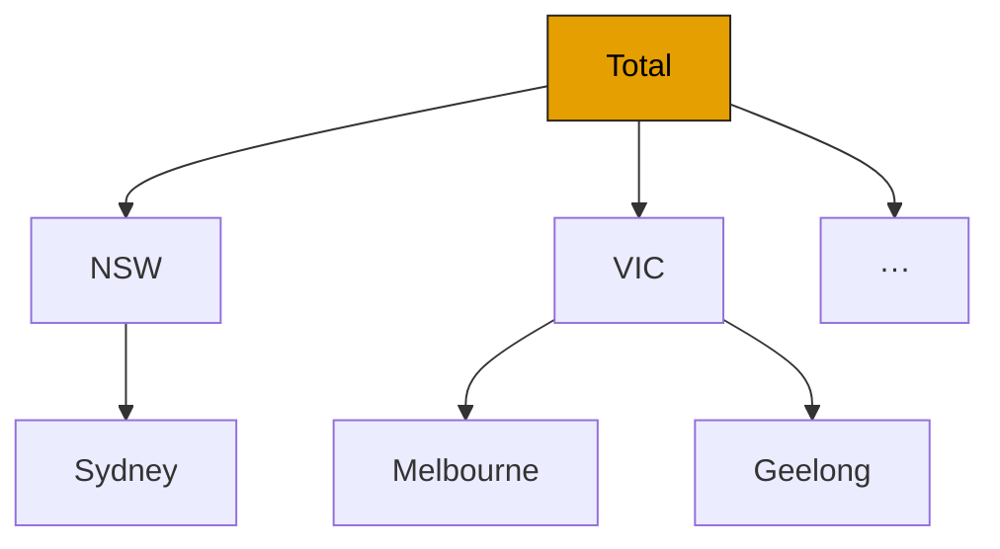

- Forecast only the **total** (highlighted).
- **Disaggregate** it with proportions $p_j$ (arrows point down).
- Three ways to estimate $p_j$:

1.  **Average historical proportions**: $p_j = \frac{1}{T}\sum_{t=1}^{T} \frac{y_{j,t}}{y_{\text{Total},t}}$
2.  **Proportions of historical averages**: $p_j = \bar{y}_j / \bar{y}_{\text{Total}}$
3.  **Forecast proportions** (default): $p_j$ from the base forecasts of each level, so they can change over the horizon.

Code

``` r
tourism_fit |>
  reconcile(
    td_ap = top_down(base, method = "average_proportions"),
    td_pa = top_down(base, method = "proportion_averages"),
    td_fp = top_down(base, method = "forecast_proportions")
  )
```

------------------------------------------------------------------------

Code

``` r
td_p <- plot_base_vs_rec(tourism_single_fc, "td") +
  labs(title = "Top-down: base vs. reconciled")
```

[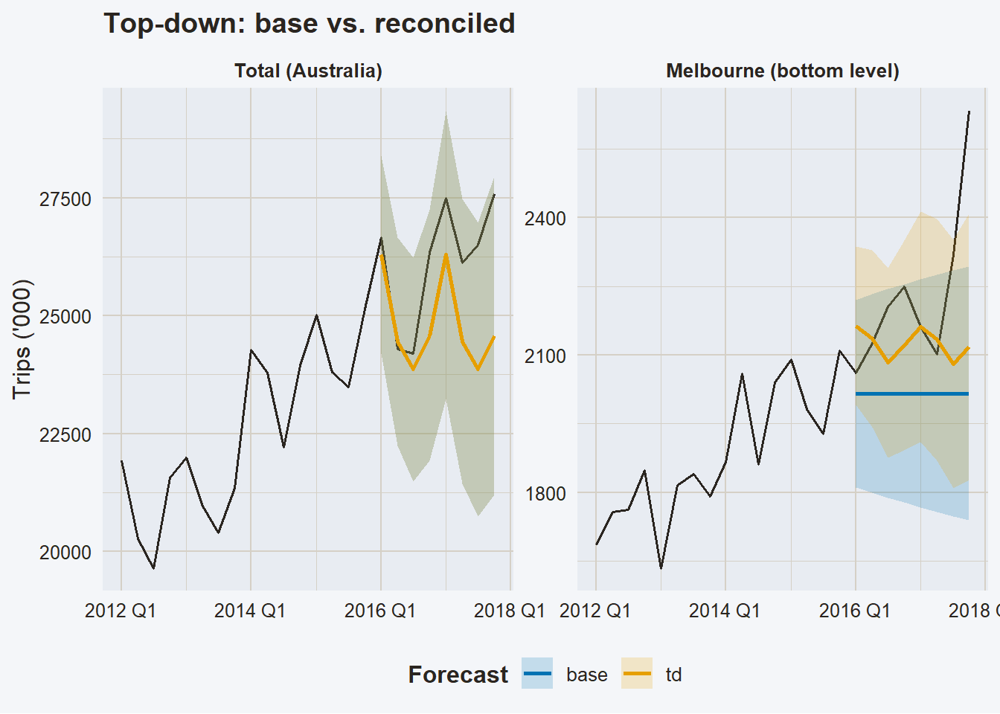](hierarchical_files/figure-html/td-plot-render-1.png)

[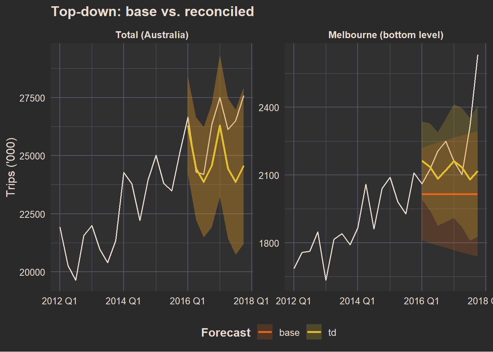](hierarchical_files/figure-html/td-plot-render-2.png)

The mirror image of bottom-up: the total is untouched, and Melbourne is now a share of the national forecast. Any local dynamic that the total does not see is lost.

## 4.3 Middle-Out

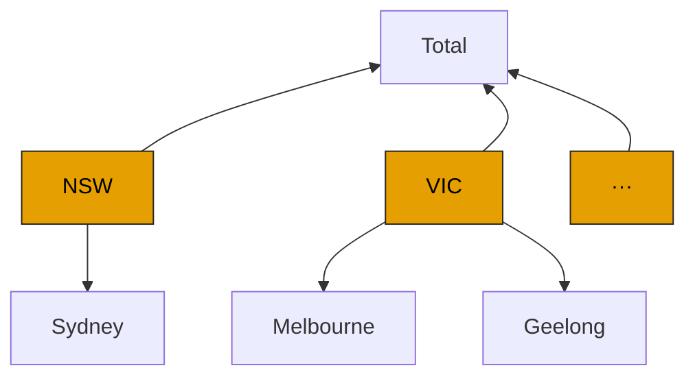

- Forecast one **middle level** (here: states, `split = 1`).
- **Sum up** to the total (bottom-up logic above).
- **Split down** to regions with forecast proportions (top-down logic below).

------------------------------------------------------------------------

Code

``` r
mo_p <- plot_base_vs_rec(tourism_single_fc, "mo") +
  labs(title = "Middle-out: base vs. reconciled")
```

[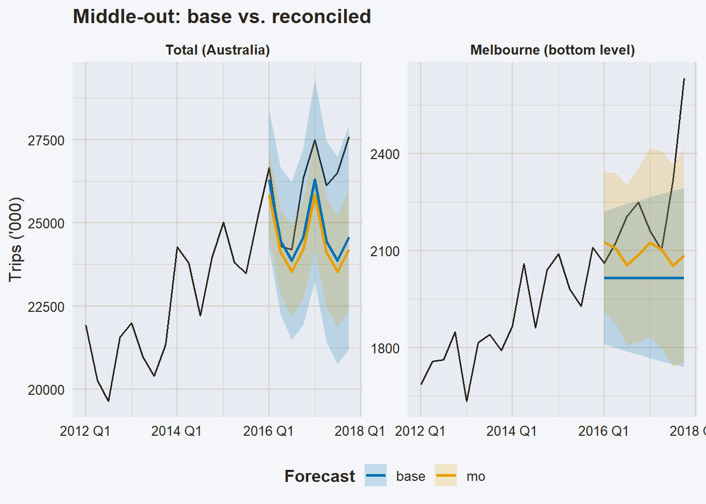](hierarchical_files/figure-html/mo-plot-render-1.png)

[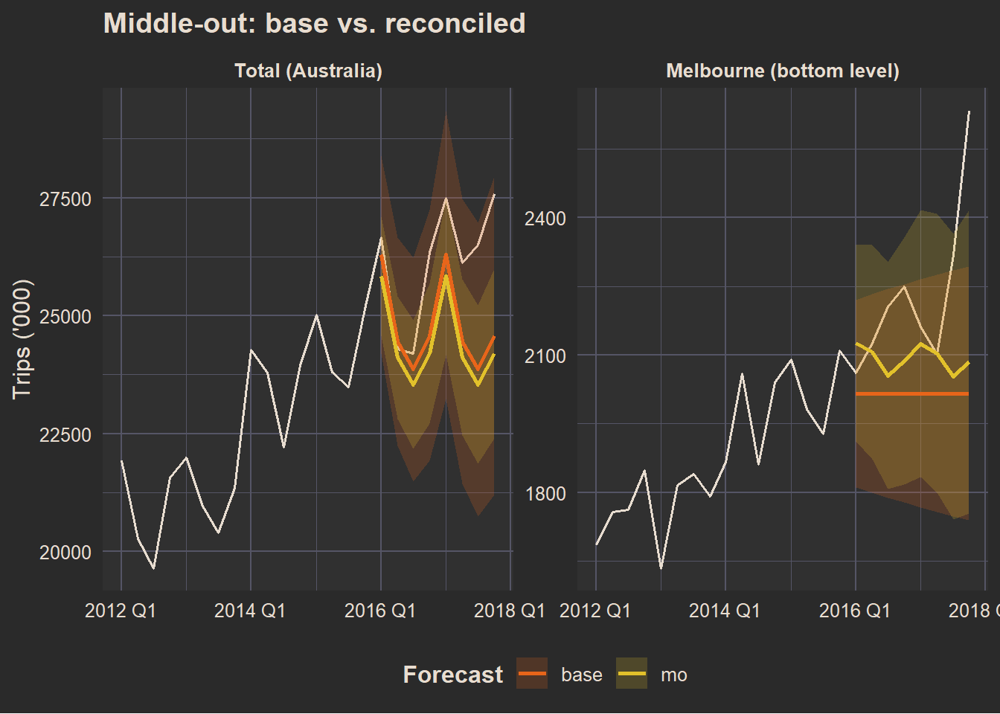](hierarchical_files/figure-html/mo-plot-render-2.png)

Both panels change: the total becomes the sum of the state forecasts, and Melbourne becomes a share of the Victoria forecast.

## 4.4 Comparing Single-Level Approaches

|  | **Bottom-up** | **Top-down** | **Middle-out** |
|:---|:---|:---|:---|
| **Information used** | Bottom-level base forecasts only | Total base forecast + proportions | One middle level + proportions below it |
| **Preserves bottom-level detail** | Yes — bottom forecasts unchanged | No — bottom series inherit the total’s dynamics | Down to the middle level only |
| **Works with grouped / mixed structures** | Yes | No — `forecast()` aborts | No — `forecast()` aborts |
| **Typical failure mode** | Noisy bottom series add up to a poor total; aggregate intervals too narrow | Proportions drift; local dynamics lost | Arbitrary choice of level; inherits both failure modes |
| **When to use** | Bottom series are clean and informative | Bottom series are too noisy or sparse | One level is the natural planning level |

> **NOTE:**
>
> With a grouped or mixed structure there is no single path from the total to the bottom level — each bottom series has more than one parent — so “split the total by proportions” is not uniquely defined. `fabletools` checks this when forecasting. `reconcile()` itself succeeds, but `forecast()` stops with:
>
>     Top down reconciliation requires strictly hierarchical structures.
>     Middle out reconciliation requires strictly hierarchical structures.
>
> We verified this on `sales_grp` (`product * channel`) and on `sales_mixed` (`(state / city) * product`). `bottom_up()` and `min_trace()` work on all three structures.

> **IMPORTANT:**
>
> All three methods trust one level completely and throw away the base forecasts of every other level. No level is noise-free. **What if we used *all* levels at once?** That is forecast reconciliation.

# 5 The Forecasting Pipeline

### 5.0.1 The Complete Workflow

Code

``` r
data |>                  #<1>
  aggregate_key(...) |> #<2>
  model(...) |>         #<3>
  reconcile(...) |>     #<4>
  forecast(h = ...)     #<5>
```

1.  A standard `tsibble`.
2.  Define the hierarchy and compute all aggregations automatically.
3.  Fit base models at **every** level.
4.  Wrap base models with reconciliation strategies.
5.  Generate coherent forecasts for all levels and all methods.

# 6 Forecast Reconciliation

## 6.1 The Incoherence

Recall the [incoherence gap](#sec-coherent): the base forecast of the national total and the sum of the 76 regional base forecasts disagree. Single-level approaches close the gap by declaring one level right. **Reconciliation** lets every level move.

> **IMPORTANT:**
>
> **How do we distribute the incoherence?**

## 6.2 A Tiny Example

One total and two bottom series: $\text{Total} = A + B$. Our base forecasts are

|               | Total |   A |   B |
|:--------------|------:|----:|----:|
| Base forecast |   100 |  50 |  40 |

But $A + B = 90$. The **gap** is 10. **Who absorbs it?**

- The total comes down to 90?
- A and B go up until they sum to 100?
- Everyone moves a little? Then who moves most?

## 6.3 Different Answers

| Method | Rule | Total | A | B |
|----|----|---:|---:|---:|
| *Base (incoherent)* | A + B falls short by 10.0 | 100.0 | 50.0 | 40.0 |
| Bottom-up | Total absorbs the whole gap | 90.0 | 50.0 | 40.0 |
| Top-down (base proportions) | Parts absorb the whole gap | 100.0 | 55.6 | 44.4 |
| OLS, W = I | Split equally | 96.7 | 53.3 | 43.3 |
| WLS, W = diag(4, 1, 1) | Noisiest forecast gets corrected most | 93.3 | 51.7 | 41.7 |
| MinT, var(4, 1, 1), cov(A, B) = 0.8 | If A and B err together, their sum is less trustworthy | 94.7 | 52.4 | 42.4 |

Every row is coherent ($A + B = \text{Total}$) and closes the same gap of 10. The methods differ **only in who absorbs it**.

> **NOTE:**
>
> **1. The summing matrix.** Stack every series in $\mathbf y_t$ and the bottom-level series in $\mathbf b_t$. For the toy example,
>
> $$\underbrace{\begin{bmatrix} y_{T,t}\\ y_{A,t}\\ y_{B,t}\end{bmatrix}}_{\mathbf y_t} = \underbrace{\begin{bmatrix}1&1\\1&0\\0&1\end{bmatrix}}_{S}\underbrace{\begin{bmatrix}y_{A,t}\\ y_{B,t}\end{bmatrix}}_{\mathbf b_t}$$
>
> $S$ says how every series is built from the bottom level. In general $S$ is $n \times m$: $n$ series, $m$ of them at the bottom. For tourism, $n = 85$ and $m = 76$.
>
> **2. The mapping matrix** $G$. Every linear method takes all $n$ base forecasts $\hat{\mathbf y}_h$ and returns $m$ bottom-level forecasts, $\tilde{\mathbf b}_h = G\hat{\mathbf y}_h$. For the toy example (columns: Total, A, B):
>
> $$G_{BU} = \begin{bmatrix}0&1&0\\0&0&1\end{bmatrix}, \qquad G_{OLS} = \tfrac13\begin{bmatrix}1&2&-1\\1&-1&2\end{bmatrix}, \qquad G_{WLS} = \tfrac16\begin{bmatrix}1&5&-1\\1&-1&5\end{bmatrix}$$
>
> Bottom-up ignores the total. OLS uses it: for example,
>
> $$\tilde b_A^{OLS} = \frac{100 + 2\cdot 50 - 40}{3} = 53.3.$$
>
> **3. Putting it together.** Coherent forecasts are rebuilt from the bottom level with $S$:
>
> $$\tilde{\mathbf y}_h = S\,G\,\hat{\mathbf y}_h$$
>
> The first row of $SG$ is the **recipe for the reconciled total**:
>
> | Method | First row of $SG$ | Reconciled total |
> |:---|:---|---:|
> | Bottom-up | $[0,\ 1,\ 1]$ | $0 \cdot 100 + 50 + 40 = 90.0$ |
> | OLS | $[\tfrac23,\ \tfrac13,\ \tfrac13]$ | 96.7 |
> | WLS | $[\tfrac13,\ \tfrac23,\ \tfrac23]$ | 93.3 |
>
> Its first entry is the **weight on the base forecast of the total**, the quantity plotted for tourism in [Figure 1](#fig-weight-total).
>
> **4. The general solution (MinT).** Let $W_h = \operatorname{Var}(\mathbf y_{T+h} - \hat{\mathbf y}_h)$ be the covariance matrix of the base forecast errors. MinT (*minimum trace*; Wickramasuriya, Athanasopoulos & Hyndman, 2019) picks the $G$ that minimizes the sum of the reconciled error variances of **all** series,
>
> $$\min_G \operatorname{tr}\!\left(\operatorname{Var}[\mathbf y_{T+h} - \tilde{\mathbf y}_h]\right) \quad \text{subject to} \quad GS = I_m,$$
>
> where $GS = I_m$ guarantees that unbiased base forecasts give unbiased reconciled forecasts (top-down violates it). The solution is
>
> $$G = (S'W_h^{-1}S)^{-1}S'W_h^{-1}.$$
>
> Every row of the toy table with a $W$ is this formula: **OLS** uses $W_h = I$, **WLS** a diagonal $W_h$, and **MinT** a full $W_h$ with covariances.

> **NOTE:**
>
> With TSLM we estimated $\boldsymbol\beta$ by OLS, $\hat{\boldsymbol\beta} = (X'X)^{-1}X'\mathbf y$, which is the best linear unbiased estimator when the errors are uncorrelated with equal variance, $\operatorname{Var}(\boldsymbol\varepsilon) = \sigma^2 I$.
>
> When $\operatorname{Var}(\boldsymbol\varepsilon) = \Sigma$ is not proportional to $I$ — some observations are noisier, or errors are correlated — OLS is still unbiased but no longer efficient. **Generalized least squares** reweights the data:
>
> $$\hat{\boldsymbol\beta}_{GLS} = (X'\Sigma^{-1}X)^{-1}X'\Sigma^{-1}\mathbf y$$
>
> Noisy observations get less weight; correlated observations count less because they partly repeat the same information. **WLS** is the special case where $\Sigma$ is diagonal. Equivalently, GLS is OLS after “whitening” the data with $\Sigma^{-1/2}$.
>
> In reconciliation: $\mathbf y \to \hat{\mathbf y}_h$, $X \to S$, $\boldsymbol\beta \to$ bottom-level forecasts, $\Sigma \to W_h$. Treat the base forecasts as noisy observations of the true bottom-level values, $\hat{\mathbf y}_h = S\boldsymbol\beta_h + \boldsymbol\varepsilon_h$: then $G\hat{\mathbf y}_h$ is exactly the GLS estimate of $\boldsymbol\beta_h$.

### 6.3.1 The geometry of reconciliation

Coherent forecasts $(\text{Total}, A, B)$ satisfy $\text{Total} = A + B$: they lie on a **plane** in $\mathbb R^3$ spanned by the columns of $S$. Every method in the table **projects** the incoherent base forecast onto that plane; they only differ in the direction.

Rotate the plot: bottom-up drops straight down in the Total direction, top-down moves only within $A$ and $B$, the OLS segment is perpendicular to the plane, and the WLS and MinT segments lean so that the noisy total absorbs most of the adjustment. **Choosing** $W_h$ chooses the direction of projection.

## 6.4 Who Decides the Weights?

For real data we don’t pick $W$ by hand. Once $S$ is fixed by the structure, **the only unknown left is** $W_h$, and the `min_trace()` methods are different estimates of it, ordered from estimating nothing to estimating everything:

| `method =` | Plain-language rule | $W_h \propto$ | Needs residuals | Aggregate intervals |
|:---|:---|:---|:--:|:---|
| `"ols"` | Treat all series equally | $I$ | No | Too narrow[^1] |
| `"wls_struct"` | Weight by the number of bottom series aggregated | $\operatorname{diag}(S\mathbf 1)$ | No | Too narrow[^2] |
| `"wls_var"` (**default**) | Weight by in-sample noise | $\operatorname{diag}(\hat W_1)$ | Yes | Too narrow[^3] |
| `"mint_cov"` | Noise + correlations, unregularized; needs $T \gg n$ | $\hat W_1$ (sample) | Yes | Use estimated correlations |
| `"mint_shrink"` | Noise + correlations, regularized | $\lambda D + (1-\lambda)\hat W_1$ | Yes | Use estimated correlations |

$\hat W_1$ is estimated from the **one-step in-sample residuals** of the base models. All methods assume $W_h = k_h W_1$ for some constant $k_h$, which cancels in $G$: the same $G$ is used at every horizon.

> **NOTE:**
>
> For the tourism hierarchy: $n =$ 85 series and $T =$ 72 training quarters.
>
> - A full covariance matrix has $n(n+1)/2 =$ **3,655** parameters, estimated from 72 residual vectors.
> - The sample covariance has rank at most $T - 1 =$ 71 $< n$ (computed rank: 71). It is **singular**, so $\hat W_1^{-1}$ does not exist.
>
> Code
>
> ``` r
> # The full error trace is suppressed for readability: print only the message
> # of the underlying error (dplyr wraps it in an "In argument: ..." layer).
> tryCatch(
>   tourism_fit |>
>     reconcile(mint_cov = min_trace(base, method = "mint_cov")) |>
>     forecast(h = 1),
>   error = \(e) {
>     while (!is.null(e$parent)) e <- e$parent
>     cat(conditionMessage(e))
>   }
> )
> ```
>
>     min_trace needs covariance matrix to be positive definite.
>
> `"mint_shrink"` pulls the sample covariance toward its diagonal:
>
> $$\hat W_1^{*} = \lambda D + (1 - \lambda)\hat W_1, \qquad D = \operatorname{diag}(\hat W_1)$$
>
> - $\lambda = 1$ → $D$: no correlations, i.e. `"wls_var"`.
> - $\lambda = 0$ → $\hat W_1$: full sample covariance, i.e. `"mint_cov"`.
> - `"mint_shrink"` **interpolates** between them, and any $\lambda > 0$ makes the matrix invertible.
>
> $\lambda$ is estimated from the data (Schäfer & Strimmer, 2005; a Ledoit–Wolf-type estimator, as used by Wickramasuriya et al., 2019):
>
> $$\hat\lambda = \frac{\sum_{i \ne j}\widehat{\operatorname{Var}}(\hat r_{ij})}{\sum_{i \ne j}\hat r_{ij}^2}$$
>
> where $\hat r_{ij}$ are the residual correlations. Noisy correlations (large variance) or weak correlations (small $\hat r_{ij}^2$) → more shrinkage. For the tourism base models, $\hat\lambda =$ **0.51**.
>
> This is **regularization**, like ridge regression: trade a little bias for much less estimation variance.

## 6.5 In Code

A single train/test split can crown a different winner depending on where it falls — the lesson of [Time Series Cross-Validation](../../../../docs/modules/module_4/03_cv/ts_cv.llms.md#rolling-origin-evaluation). We compare methods over **5 rolling origins**, forecasting 4 quarters ahead each time.

Code

``` r
tourism_cv <- tourism_hts |>
  filter_index(. ~ "2016 Q4") |>                       #<1>
  stretch_tsibble(.init = 64, .step = 3, .id = ".id")  #<2>
```

1.  The last origin must leave 4 quarters of test data before the end of the data (2017 Q4).
2.  Training sets end in 2013 Q4, 2014 Q3, 2015 Q2, 2016 Q1, and 2016 Q4.

Code

``` r
reconcile_fold <- function(fold) {
  fold |>
    update_tsibble(key = c(State, Region)) |>    #<1>
    select(-.id) |>
    model(base = ETS(Trips)) |>
    reconcile(
      bu          = bottom_up(base),
      td          = top_down(base),
      mo          = middle_out(base, split = 1),
      ols         = min_trace(base, method = "ols"),
      wls_struct  = min_trace(base, method = "wls_struct"),
      wls_var     = min_trace(base, method = "wls_var"),
      mint_shrink = min_trace(base, method = "mint_shrink")
    ) |>
    forecast(h = 4) |>
    as_tibble()
}

tourism_cv_fc <- tourism_cv |>
  group_split(.id) |>                                                  #<2>
  map(\(fold) reconcile_fold(fold) |> mutate(.id = fold$.id[1])) |>
  list_rbind() |>
  as_fable(index = Quarter, key = c(State, Region, .model, .id),       #<3>
           distribution = Trips, response = "Trips")
```

1.  Drop `.id` from the key. Otherwise `reconcile()` would treat the folds as one big hierarchy: `top_down()` and `middle_out()` would abort, and `min_trace()` would estimate covariances *between folds*.
2.  Fit, reconcile, and forecast each fold separately.
3.  Stack the folds back into one fable, with `.id` as a key.

MASE and RMSSE are scaled, so they can be averaged across series of very different sizes. We average **within each level**: a pooled RMSE would be dominated by the national total, whose errors are hundreds of times larger than a region’s.

Code

``` r
tourism_cv_accu <- tourism_cv_fc |>
  accuracy(tourism_hts,                                   #<1>
           measures = list(MASE = MASE, RMSSE = RMSSE),
           by = c(".model", "State", "Region", ".id"))    #<2>

tourism_cv_level <- tourism_cv_accu |>
  mutate(level = case_when(
    is_aggregated(State)  ~ "Total",
    is_aggregated(Region) ~ "State",
    .default = "Region"
  )) |>
  summarise(MASE = mean(MASE), RMSSE = mean(RMSSE), .by = c(level, .model))

tourism_cv_level |>
  pivot_wider(names_from = level, values_from = c(MASE, RMSSE)) |>
  arrange(MASE_Total)
```

1.  Pass the **full** tsibble: MASE and RMSSE need the training data for their scaling, and the actual values for the test periods.
2.  One accuracy value per series and origin; the averages are taken over series within a level and over origins.

Code

``` r
cv_rank <- tourism_cv_level |>
  select(level, .model, MASE) |>
  bind_rows(
    tourism_cv_level |>
      summarise(MASE = mean(MASE), .by = .model) |>
      mutate(level = "Mean across levels")
  ) |>
  mutate(rank = min_rank(MASE), .by = level)

cv_model_order <- cv_rank |>
  filter(level == "Mean across levels") |>
  arrange(MASE) |>
  pull(.model)

cv_heatmap_p <- cv_rank |>
  mutate(
    level  = factor(level, levels = rev(c("Total", "State", "Region",
                                          "Mean across levels"))),
    .model = factor(.model, levels = cv_model_order)
  ) |>
  ggplot(aes(x = .model, y = level, fill = rank)) +
  geom_tile(colour = "white", linewidth = 1) +
  geom_text(aes(label = paste0(rank, "\n", round(MASE, 2))),
            colour = "white", fontface = "bold", size = 3.5) +
  labs(title = "Rank of each method by level (1 = best)",
       subtitle = "Label: rank and MASE, averaged over series and 5 origins",
       x = NULL, y = NULL, fill = "Rank")
```

## 6.6 Results

[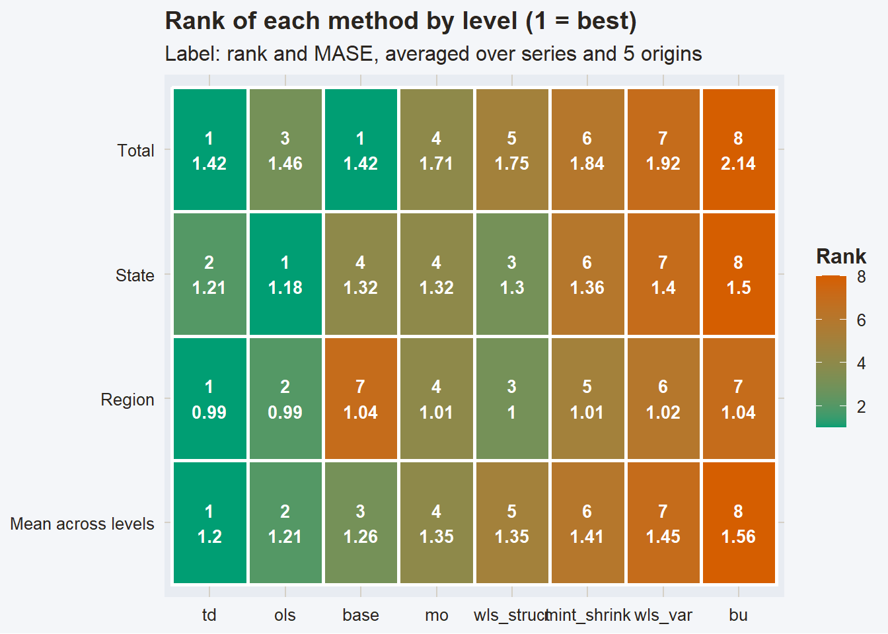](hierarchical_files/figure-html/cv-heatmap-render-1.png)

[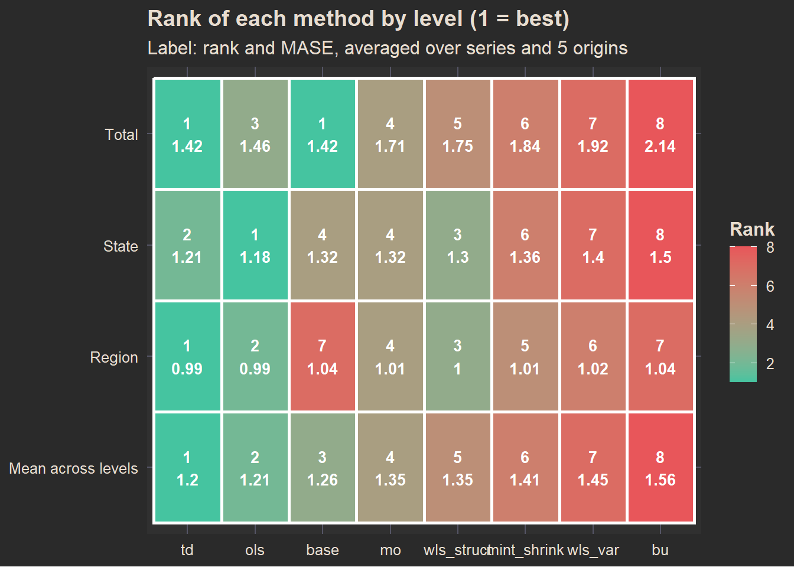](hierarchical_files/figure-html/cv-heatmap-render-2.png)

`td` and `ols` rank best on average; `bu`, `wls_var` and `mint_shrink` rank worst. The “optimal” method is not the winner here. Why?

## 6.7 Why `td` and `ols` Won: Trusting the Wrong Level

Code

``` r
weight_total_p <- weight_total |>
  ggplot(aes(x = weight, y = MASE, colour = type)) +
  geom_point(size = 3) +
  geom_text(aes(label = .model), vjust = -1, show.legend = FALSE) +
  scale_x_continuous(labels = scales::label_percent(), limits = c(-0.05, 1.05)) +
  scale_y_continuous(expand = expansion(mult = 0.15)) +
  labs(title = "The more a method trusted the base total, the better it did",
       x = "Weight on the base forecast of the total",
       y = "Mean MASE across levels", colour = NULL)
```

[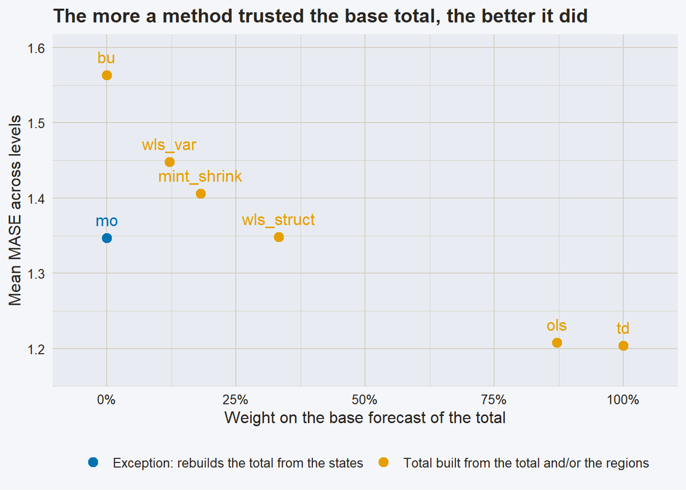](hierarchical_files/figure-html/weight-total-render-1.png "Figure 1: Weight each method puts on the base forecast of the national total when it builds the reconciled total (the total’s own entry in SG), against mean MASE across levels over the 5 origins. Weights come from a single fold (training ending 2016 Q4); they vary slightly across folds.")

[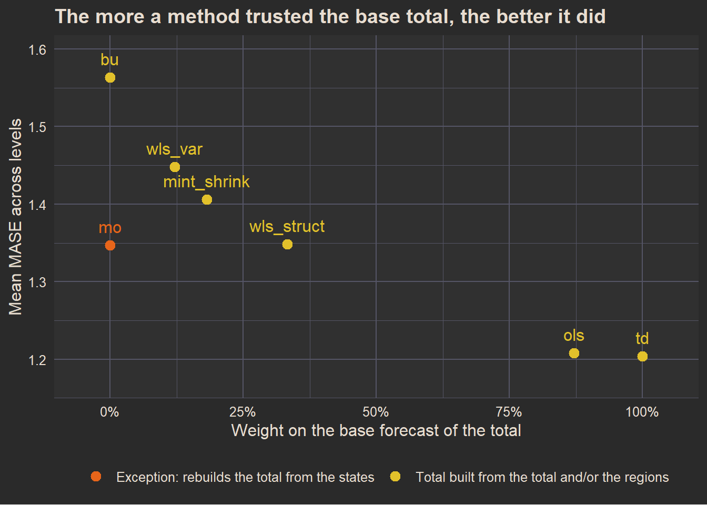](hierarchical_files/figure-html/weight-total-render-2.png "Figure 1: Weight each method puts on the base forecast of the national total when it builds the reconciled total (the total’s own entry in SG), against mean MASE across levels over the 5 origins. Weights come from a single fold (training ending 2016 Q4); they vary slightly across folds.")

Figure 1: Weight each method puts on the base forecast of the national total when it builds the reconciled total (the total’s own entry in $SG$), against mean MASE across levels over the 5 origins. Weights come from a single fold (training ending 2016 Q4); they vary slightly across folds.

Same mechanism as the toy WLS row: the series with the largest $W$ absorbs most of the correction. In-sample, the national total’s base model looked noisiest, so `wls_var` and `mint_shrink` let the regions overrule it. **Out of sample, the total was the most reliable forecast.** All base forecasts under-forecast, the bottom level most: the base total missed by -4.8%, the summed states by -5.9%, and the summed regions by -7.5%.[^4]

Even at the region level, `td` (RMSE 53.2) beat the regional base forecasts (RMSE 59.1): **splitting the national forecast beat forecasting each region directly.**

> **NOTE:**
>
> | origin | Base total (%) | Sum of regions (%) | td | ols | base | mo | wls_struct | mint_shrink | wls_var | bu |
> |---:|---:|---:|---:|---:|---:|---:|---:|---:|---:|---:|
> | 2007 Q4 | 4.1 | 2.7 | 7 | 8 | 6 | 2 | 5 | 3 | 4 | 1 |
> | 2009 Q1 | 3.1 | 5.3 | 1 | 2 | 3 | 4 | 5 | 6 | 7 | 8 |
> | 2010 Q2 | -4.1 | -3.0 | 8 | 6 | 7 | 5 | 4 | 2 | 3 | 1 |
> | 2011 Q3 | -0.7 | -2.7 | 1 | 3 | 2 | 4 | 5 | 6 | 7 | 8 |
> | 2012 Q4 | -0.7 | -2.9 | 1 | 3 | 2 | 4 | 6 | 5 | 7 | 8 |
> | 2014 Q1 | -7.9 | -9.9 | 2 | 1 | 3 | 4 | 5 | 6 | 7 | 8 |
> | 2015 Q2 | -4.1 | -7.5 | 1 | 2 | 3 | 4 | 5 | 6 | 7 | 8 |
> | 2016 Q3 | -6.2 | -8.7 | 1 | 2 | 3 | 4 | 5 | 6 | 7 | 8 |
> | Average (8 origins) |  |  | 1 | 2 | 3 | 4 | 5 | 6 | 7 | 8 |
>
> We repeated the comparison with **8 origins** (training ending 2007 Q4 to 2016 Q3, every 5 quarters, $h = 4$). Entries are the rank of each method by MASE averaged across levels (1 = best); columns are ordered by the average rank. The two error columns use the same convention as above (error = forecast − actual, as a percentage of the actual national total; positive = over-forecast) for two forecasts of the national total: the base forecast of the total, and the sum of the 76 regional base forecasts (what `bu` uses).
>
> The average ordering matches the 5-origin CV. The order reverses at 2 origins (2007 Q4 and 2010 Q2). This is not new evidence but the **same mechanism as [Figure 1](#fig-weight-total), seen origin by origin**: a method wins when it trusts the level whose base forecast turns out more accurate. At those origins the summed regional forecasts came closer to the actual total than the base forecast of the total, so `bu` won; at the others it was the reverse, so `td` won. The sign of the error does not decide it (at 2009 Q1 both over-forecast, but the regions missed by more). And the $W$ estimates cannot know in advance which level will be more accurate: they only see in-sample one-step residuals.

## 6.8 What the Cross-Validation Tells Us

> **IMPORTANT:**
>
> - **No method wins at every level or at every origin.** On average, `td` and `ols` rank best and `bu`, `wls_var` and `mint_shrink` worst. At origins where the summed regional forecasts were closer to the actual total than the base forecast of the total, the order reverses.
> - **The ranking tracks how much each method trusts the base forecast of the total** ([Figure 1](#fig-weight-total)). Middle-out is the exception: it rebuilds the total from the state forecasts, not from the regions.
> - **Why?** Base forecasts at every level were biased in the same direction, and the bottom-level ones more so in relative terms. *Aggregation cancels noise, not bias*: summing same-sign errors adds them up.
> - **MinT is optimal in trace only if the base forecasts are unbiased and** $W_h$ is known. Its $W$ is estimated from in-sample one-step residuals, which measure variance, not out-of-sample bias, so it cannot see this problem.
> - **Takeaway:** check the bias of your base forecasts *by level* before reconciling. Reconciliation redistributes errors; it does not remove a shared bias. Fix the base models first.

# 7 Mixed Structure in Practice: PBS

The `PBS` dataset records monthly Medicare Australia pharmaceutical prescriptions. It has a natural mixed structure: drug categories nest hierarchically (ATC1 → ATC2), and the Concession type (Concessional / General) is an independent grouping attribute.

Code

``` r
pbs_hts <- PBS |>
  filter(ATC1 %in% c("A", "C", "G", "N")) |>       #<1>
  aggregate_key(ATC1 / ATC2 * Concession,           #<2>
                Cost = sum(Cost) / 1e6)

pbs_train <- pbs_hts |>
  filter_index(. ~ "2006 Jun")

pbs_hts
```

1.  Restrict to four ATC1 categories to keep the example manageable.
2.  `ATC1 / ATC2` is the hierarchy; `* Concession` crosses it with the grouping attribute. Cost is scaled to millions.

## 7.1 PBS: Reconciliation

Because this is a mixed structure, `top_down()` and `middle_out()` are not available; we compare bottom-up with two reconciliation methods.

Code

``` r
pbs_fit <- pbs_train |>
  model(ets = ETS(Cost))

pbs_rec <- pbs_fit |>
  reconcile(
    bu   = bottom_up(ets),
    ols  = min_trace(ets, method = "ols"),
    wls  = min_trace(ets, method = "wls_struct")
  )

pbs_fc <- pbs_rec |>
  forecast(h = "2 years")
```

## 7.2 PBS: Accuracy

Code

``` r
pbs_accuracy_p <- pbs_fc |>
  accuracy(data = pbs_hts, measures = list(RMSSE = RMSSE)) |>
  mutate(
    Level = case_when(
      is_aggregated(ATC1) & is_aggregated(Concession) ~ "Total",
      is_aggregated(ATC1)                             ~ "Concession",
      is_aggregated(ATC2) & is_aggregated(Concession) ~ "ATC1",
      is_aggregated(ATC2)                             ~ "ATC1 × Concession",
      is_aggregated(Concession)                       ~ "ATC2",
      .default = "ATC2 × Concession"
    )
  ) |>
  group_by(.model, Level) |>
  summarise(RMSSE = mean(RMSSE, na.rm = TRUE), .groups = "drop") |>
  mutate(
    Level  = factor(Level, levels = c("Total", "Concession", "ATC1",
                                      "ATC1 × Concession", "ATC2",
                                      "ATC2 × Concession")),
    .model = fct_reorder(.model, RMSSE)
  ) |>
  ggplot(aes(x = .model, y = RMSSE, fill = .model)) +
  geom_col(show.legend = FALSE) +
  facet_wrap(~ Level, scales = "free_y") +
  coord_flip() +
  labs(x = NULL, y = "Mean RMSSE")
```

[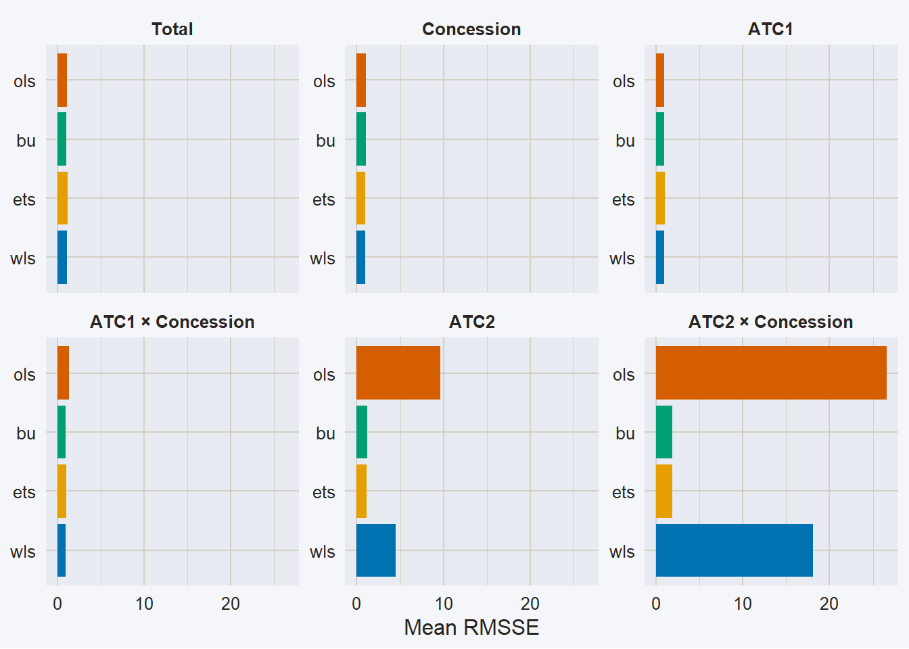](hierarchical_files/figure-html/pbs-accuracy-render-1.png)

[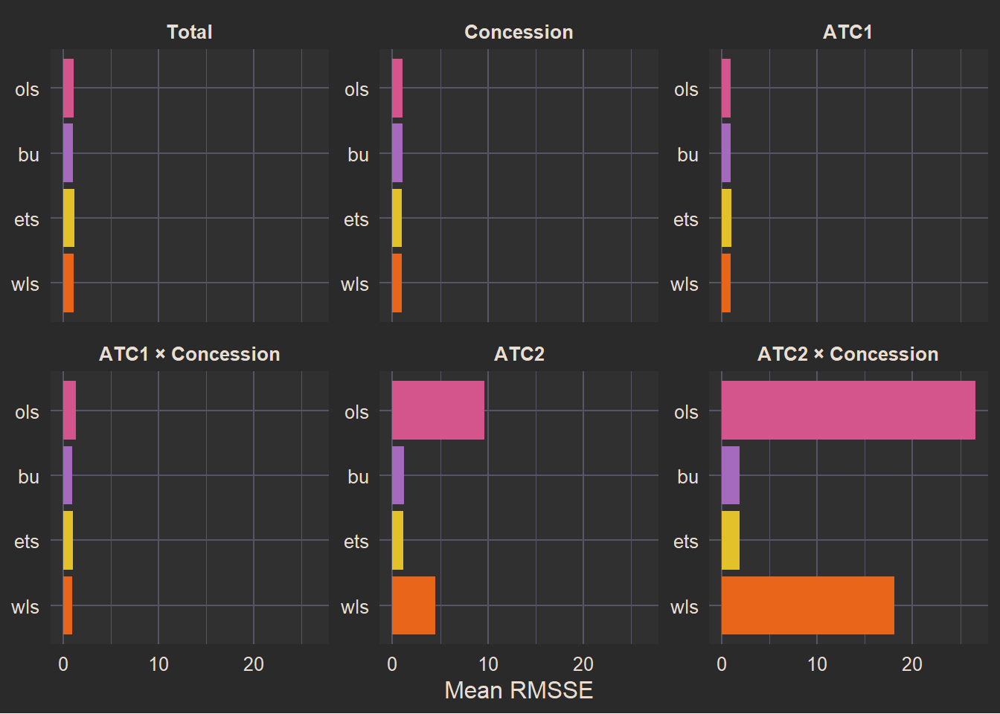](hierarchical_files/figure-html/pbs-accuracy-render-2.png)

# 8 Summary

| Topic | Key takeaway |
|:---|:---|
| **Structures** | Hierarchical nests (`/`); grouped crosses (`*`) — two trees sharing total and bottom; mixed combines both. |
| **Coherence** | Independent base forecasts don’t add up; the gap is real and visible. |
| **Single-level** | BU, TD, MO trust one level. TD and MO only work for strictly hierarchical structures. |
| **Linear reconciliation** | Every method is $\tilde{\mathbf y}_h = SG\hat{\mathbf y}_h$; unbiasedness needs $GS = I$. |
| **MinT** | GLS projection: $G = (S'W_h^{-1}S)^{-1}S'W_h^{-1}$, optimal in trace if base forecasts are unbiased. |
| **`min_trace()` methods** | Different estimates of $W_h$; `mint_shrink` regularizes when $n$ is large relative to $T$. |
| **Evaluation** | Compare by level with rolling-origin CV; no method dominates every level. |

> **TIP:**
>
> 1.  Fit base models at every level and check them for bias.
> 2.  Reconcile with `bottom_up()`, `min_trace(method = "ols")`, and `min_trace(method = "mint_shrink")` (plus `top_down()` for strict hierarchies).
> 3.  Compare with rolling-origin CV, using scaled errors **by level**.

Back to top

## Footnotes

[^1]: `fabletools` computes each reconciled variance as $\operatorname{diag}(S G\, W_h\, G' S')$, building $W_h$ from each series’ own forecast variances and the **correlations** implied by the method’s $W$. For a diagonal $W$ (`"ols"`, `"wls_struct"`, `"wls_var"`, and also `bottom_up()`), all covariances are set to zero. When the base forecast errors are positively correlated, the intervals of aggregate series come out too narrow.

[^2]: `fabletools` computes each reconciled variance as $\operatorname{diag}(S G\, W_h\, G' S')$, building $W_h$ from each series’ own forecast variances and the **correlations** implied by the method’s $W$. For a diagonal $W$ (`"ols"`, `"wls_struct"`, `"wls_var"`, and also `bottom_up()`), all covariances are set to zero. When the base forecast errors are positively correlated, the intervals of aggregate series come out too narrow.

[^3]: `fabletools` computes each reconciled variance as $\operatorname{diag}(S G\, W_h\, G' S')$, building $W_h$ from each series’ own forecast variances and the **correlations** implied by the method’s $W$. For a diagonal $W$ (`"ols"`, `"wls_struct"`, `"wls_var"`, and also `bottom_up()`), all covariances are set to zero. When the base forecast errors are positively correlated, the intervals of aggregate series come out too narrow.

[^4]: Bias convention used throughout: error = forecast − actual, summed over the series of a level (and over horizons and origins), as a percentage of the actual national total. Positive = over-forecast.
