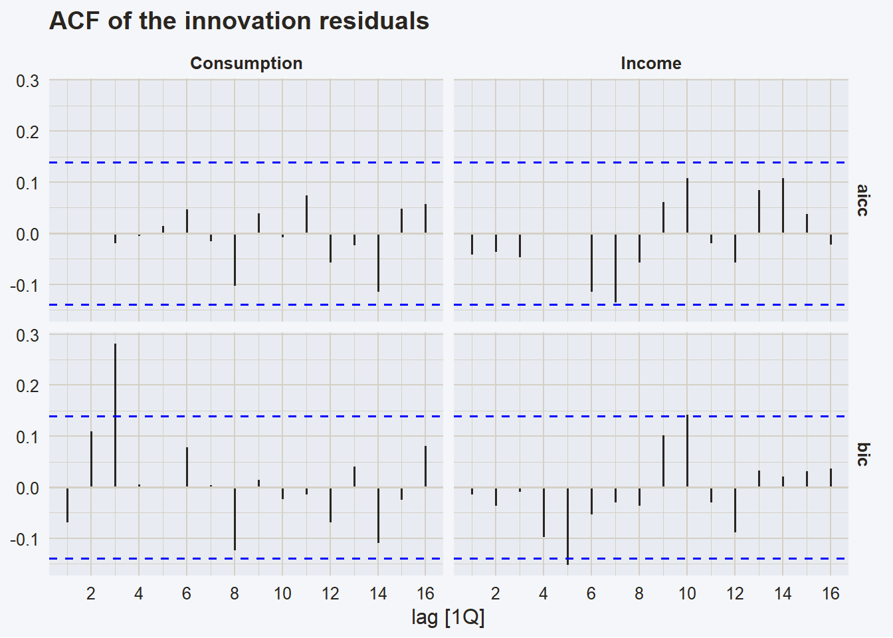
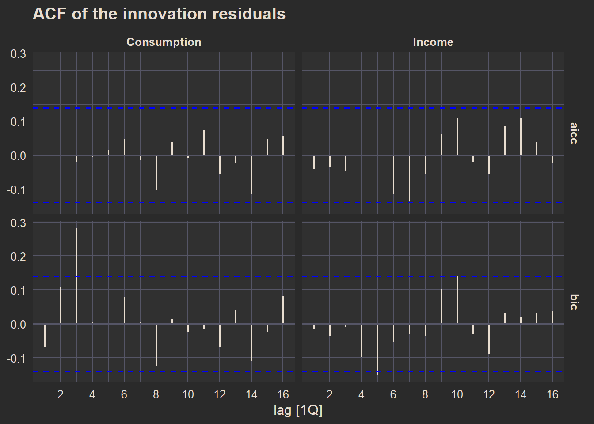
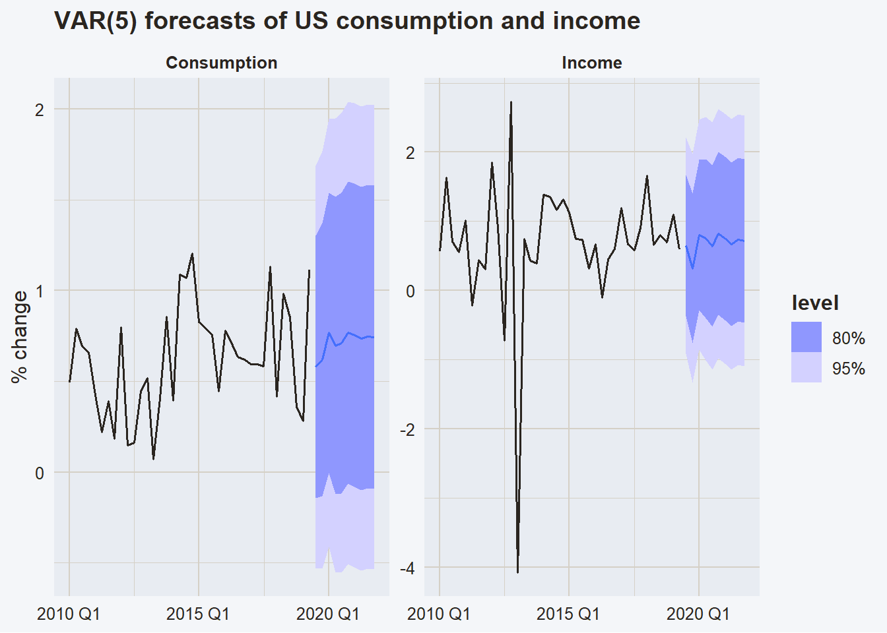
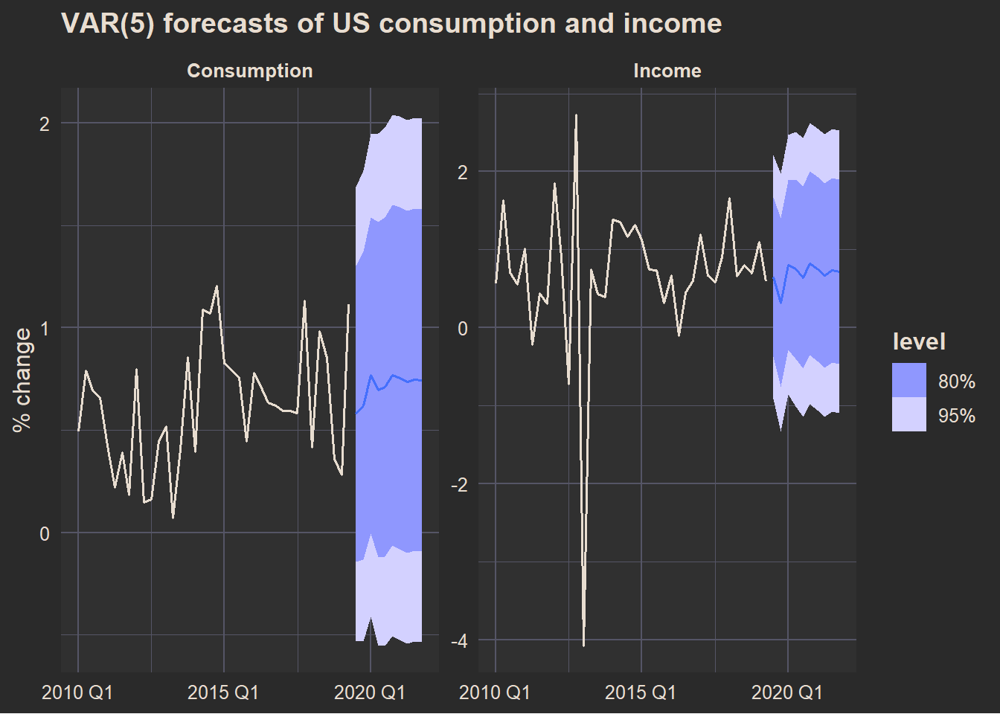
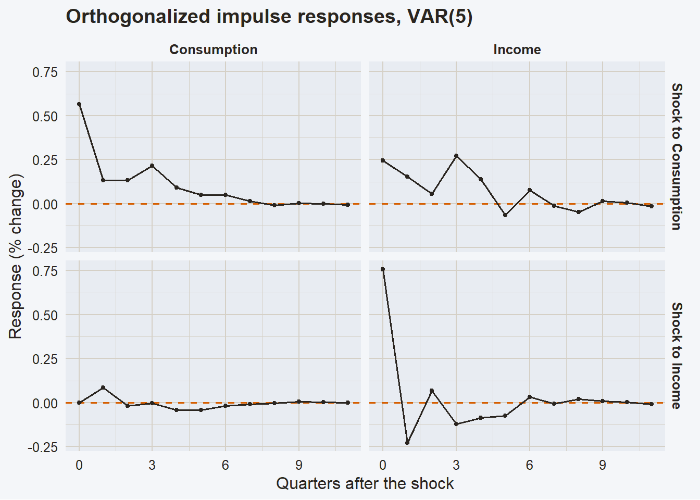
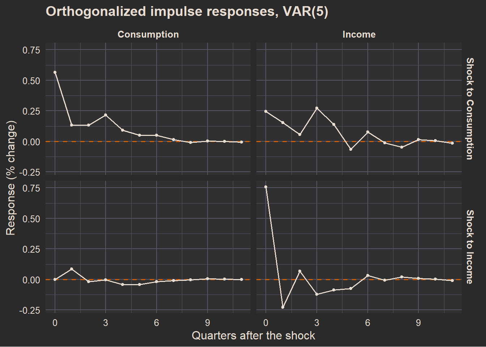
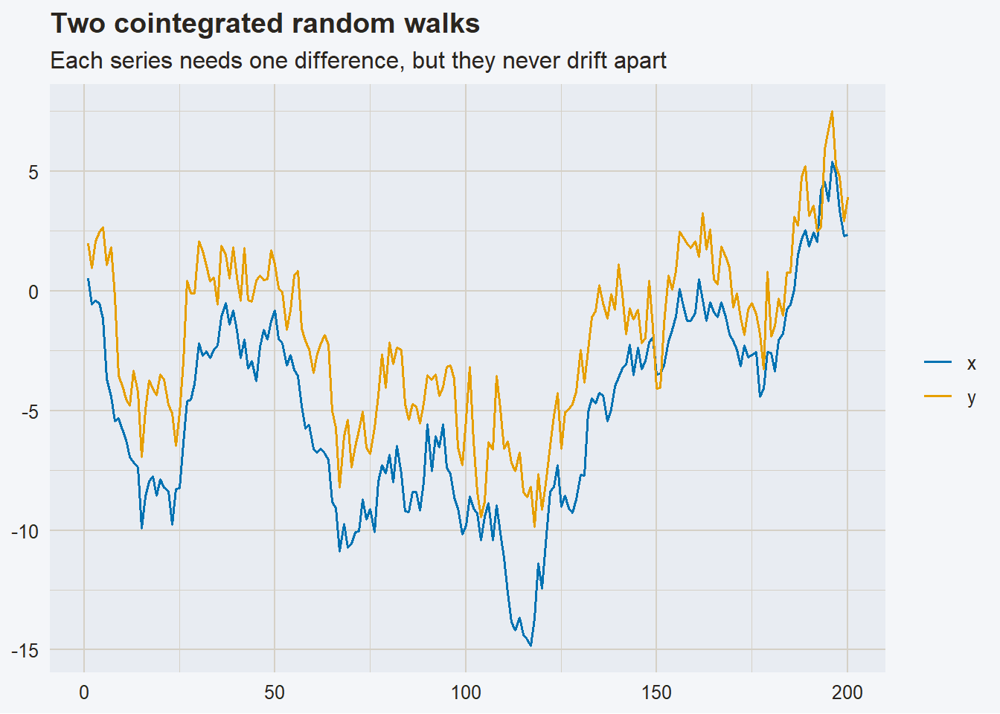
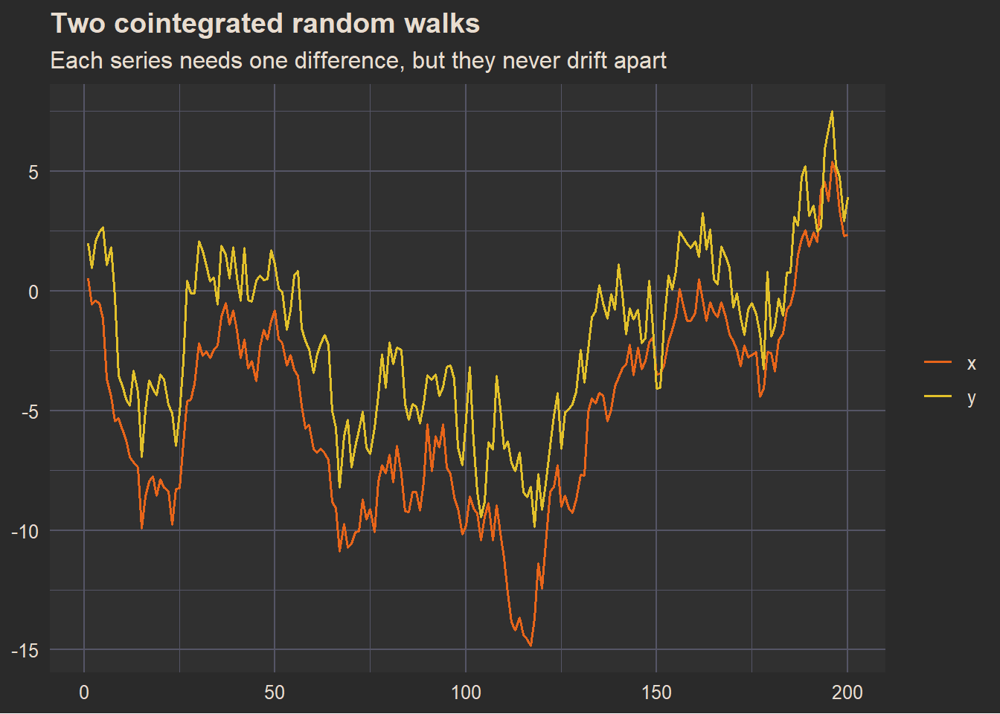
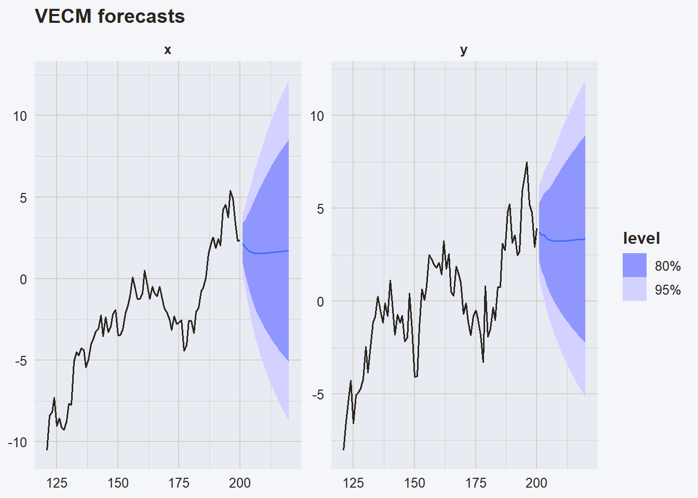
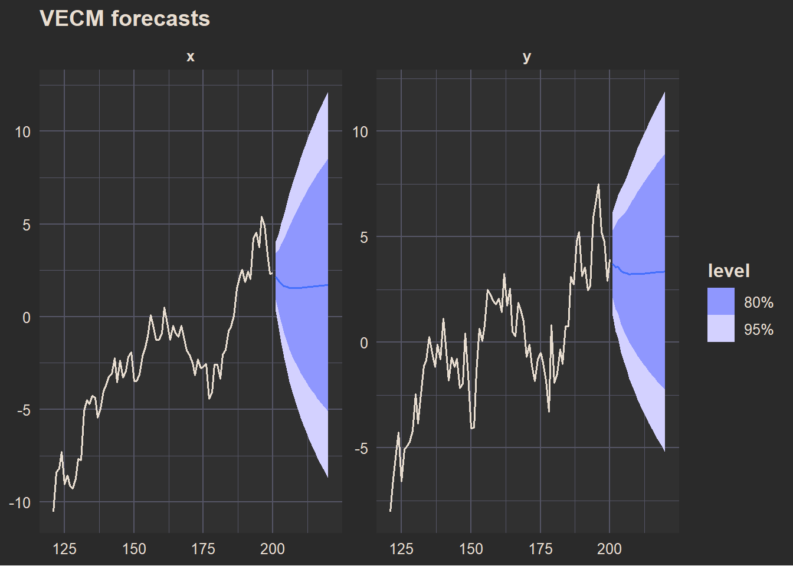

# Vector Autoregressions (VAR)

Modified

November 18, 2026

Code

``` r
library(plotly) #<1>
```

1.  For interactive plots in the HTML version. Later we also call `lmtest::grangertest()` and `urca::ca.jo()` with the `::` operator instead of loading those packages, because `lmtest` loads `zoo`, which masks `tsibble::index()`.

Every model with predictors we have built so far has the same shape:

$$y_t = \beta_0 + \beta_1 x_{1,t} + \cdots + \beta_k x_{k,t} + \eta_t$$

Information flows **one way**: the predictors $x$ drive the forecast variable $y$, and $y$ never feeds back into $x$.

That assumption causes two practical problems:

1.  **Feedback is ignored.** If $y$ also affects $x$, the model sees only half of the relationship.
2.  **We still need to forecast** $x$. In [Session 3.3](../../../../docs/modules/module_3/03_dynamic/dynamic_regression.llms.md) we forecast US consumption with Income as a predictor, and we had to invent future Income values with a `MEAN()` scenario. The quality of the consumption forecast depended on a forecast nobody checked.

> **IMPORTANT:**
>
> What if we stop deciding which variable is the predictor and which is the response? A **vector autoregression** treats every variable the same way: each one is explained by the past of all of them, and the model forecasts all of them together.

# 1 Feedback in Real Data

## 1.1 The Australian Stimulus

FPP3 uses the 2008–2009 Australian stimulus to motivate VAR models. The government paid stimulus money to households in December 2008, just before Christmas.

- The payments **increased retail sales**.
- Higher retail sales **increased incomes** (shop wages, profits, hiring).
- Higher incomes then **fed back into spending**.

A regression of sales on income captures only one arrow of that loop. Both variables are **endogenous**: each one is determined inside the system.

## 1.2 Feedback Loops in Mexico

The same pattern appears in Mexican data. None of these are clean one-way relationships.

| Variables | Why the relationship runs both ways |
|:---|:---|
| Banxico policy rate ↔︎ inflation ↔︎ USD/MXN exchange rate | Banxico raises the rate **because** inflation rises; the rate then moves inflation and the peso; a weaker peso raises import prices, which raises inflation again |
| Remittances ↔︎ exchange rate ↔︎ household consumption | A strong peso (the “superpeso” of 2023) lowers the peso value of each dollar sent home; remittance flows also affect the supply of dollars and therefore the exchange rate |
| Advertising ↔︎ sales | In the `insurance` example of Session 3.3 we treated TV advertising as given, but marketing budgets are usually **set from last period’s sales** |
| Formal employment (IMSS) ↔︎ retail sales (ANTAD) | More jobs mean more spending; more spending means stores hire more people |

> **NOTE:**
>
> Central banks use these models routinely. Researchers at Banco de México estimated a VAR on monthly data from 1997 to 2010 to measure how much of an exchange rate movement passes through to consumer prices, and found that the pass-through fell sharply after Banxico adopted inflation targeting in 2001 ([Capistrán, Ibarra & Ramos-Francia, 2011](https://econpapers.repec.org/RePEc:bdm:wpaper:2011-12)).

## 1.3 A Counterexample

Not every pair of related series needs a VAR.

Consider **US industrial production** and **Mexican manufacturing output**. Mexican factories depend heavily on US demand, but Mexican manufacturing has almost no effect on the size of the US economy. The relationship runs one way.

> **TIP:**
>
> - One-way relationship ($x \to y$) → **dynamic regression** (Session 3.3) is enough.
> - Two-way relationship ($x \leftrightarrow y$) → consider a **VAR**.

# 2 The VAR Framework

## 2.1 Starting Small: A Two-Variable VAR(1)

The simplest VAR has $K = 2$ variables and $p = 1$ lag:

$$\begin{aligned}
y_{1,t} &= c_1 + \phi_{11,1}\, y_{1,t-1} + \phi_{12,1}\, y_{2,t-1} + \varepsilon_{1,t} \\
y_{2,t} &= c_2 + \phi_{21,1}\, y_{1,t-1} + \phi_{22,1}\, y_{2,t-1} + \varepsilon_{2,t}
\end{aligned}$$

- **One equation per variable.** Each equation has its own constant and uses the lagged values of **every** variable.
- $\phi_{ij,\ell}$ is the effect of the $\ell$-th lag of variable $j$ on variable $i$. For example, $\phi_{12,1}$ measures how last period’s $y_2$ affects today’s $y_1$.
- $\varepsilon_{1,t}$ and $\varepsilon_{2,t}$ are white noise, but they **may be correlated with each other** at the same time $t$. A shock that hits consumption this quarter can also hit income this quarter.

> **NOTE:**
>
> With a single variable ($K = 1$), the system collapses to $y_t = c + \phi_1 y_{t-1} + \varepsilon_t$, the AR(1) model from Module 2. A VAR is to vectors what an AR model is to scalars.

### 2.1.1 The Same Model in Matrix Form

Stacking both equations into vectors gives a much more compact form:

$$\underbrace{\begin{bmatrix} y_{1,t} \\ y_{2,t} \end{bmatrix}}_{\mathbf{y}_t}
=
\underbrace{\begin{bmatrix} c_1 \\ c_2 \end{bmatrix}}_{\mathbf{c}}
+
\underbrace{\begin{bmatrix} \phi_{11,1} & \phi_{12,1} \\ \phi_{21,1} & \phi_{22,1} \end{bmatrix}}_{\boldsymbol{\Phi}_1}
\underbrace{\begin{bmatrix} y_{1,t-1} \\ y_{2,t-1} \end{bmatrix}}_{\mathbf{y}_{t-1}}
+
\underbrace{\begin{bmatrix} \varepsilon_{1,t} \\ \varepsilon_{2,t} \end{bmatrix}}_{\boldsymbol{\varepsilon}_t}$$

The correlation between the two errors lives in the **error covariance matrix**:

$$\boldsymbol{\Sigma} = \operatorname{Var}(\boldsymbol{\varepsilon}_t) =
\begin{bmatrix} \sigma_1^2 & \sigma_{12} \\ \sigma_{12} & \sigma_2^2 \end{bmatrix}$$

## 2.2 The General VAR(p)

With $K$ variables and $p$ lags, the matrix form extends directly:

$$\mathbf{y}_t = \mathbf{c} + \boldsymbol{\Phi}_1 \mathbf{y}_{t-1} + \boldsymbol{\Phi}_2 \mathbf{y}_{t-2} + \cdots + \boldsymbol{\Phi}_p \mathbf{y}_{t-p} + \boldsymbol{\varepsilon}_t,
\qquad \boldsymbol{\varepsilon}_t \sim \text{WN}(\mathbf{0}, \boldsymbol{\Sigma})$$

where $\mathbf{y}_t$ and $\mathbf{c}$ are $K \times 1$ vectors and each $\boldsymbol{\Phi}_\ell$ is a $K \times K$ matrix.

Written as a sum, equation $k$ of the system is:

$$y_{k,t} = c_k + \sum_{\ell=1}^{p} \sum_{j=1}^{K} \phi_{kj,\ell}\; y_{j,t-\ell} + \varepsilon_{k,t}, \qquad k = 1, \dots, K$$

The inner sum runs over **variables**, the outer sum over **lags**. Every equation has the same right-hand side: all $K$ variables at all $p$ lags.

> **NOTE:**
>
> Because every equation shares the same regressors, the VAR can be estimated **one equation at a time with least squares**. For a system with identical regressors in every equation, equation-by-equation OLS is as efficient as estimating the whole system jointly.

### 2.2.1 Counting Parameters

Each lag adds a full $K \times K$ matrix, so the number of coefficients is:

$$\underbrace{K}_{\text{constants}} + \underbrace{pK^2}_{\text{lag coefficients}} \quad \left(+ \tfrac{K(K+1)}{2} \text{ in } \boldsymbol{\Sigma}\right)$$

| $K$ | $p$ | Coefficients ($K + pK^2$) |
|:---:|:---:|:-------------------------:|
|  2  |  1  |             6             |
|  2  |  5  |            22             |
|  5  |  4  |            105            |
| 10  |  4  |            410            |

> **WARNING:**
>
> `us_change` has 198 quarterly observations. A VAR with 5 variables and 4 lags spends 105 coefficients on them, about 21 per equation estimated from fewer than 200 points. Every extra variable or lag costs a lot of estimation precision, which then shows up as wider prediction intervals.

> **NOTE:**
>
> A VAR(1) is stationary when all eigenvalues $\lambda$ of $\boldsymbol{\Phi}_1$ satisfy $|\lambda| < 1$. This is the matrix version of the AR(1) condition $|\phi_1| < 1$.
>
> A VAR(p) can always be rewritten as a VAR(1) of dimension $Kp$ by stacking the lags (the **companion form**):
>
> $$\begin{bmatrix} \mathbf{y}_t \\ \mathbf{y}_{t-1} \\ \vdots \\ \mathbf{y}_{t-p+1} \end{bmatrix}
> =
> \begin{bmatrix} \mathbf{c} \\ \mathbf{0} \\ \vdots \\ \mathbf{0} \end{bmatrix}
> +
> \begin{bmatrix}
> \boldsymbol{\Phi}_1 & \boldsymbol{\Phi}_2 & \cdots & \boldsymbol{\Phi}_{p-1} & \boldsymbol{\Phi}_p \\
> \mathbf{I} & \mathbf{0} & \cdots & \mathbf{0} & \mathbf{0} \\
> \vdots & & \ddots & & \vdots \\
> \mathbf{0} & \mathbf{0} & \cdots & \mathbf{I} & \mathbf{0}
> \end{bmatrix}
> \begin{bmatrix} \mathbf{y}_{t-1} \\ \mathbf{y}_{t-2} \\ \vdots \\ \mathbf{y}_{t-p} \end{bmatrix}
> +
> \begin{bmatrix} \boldsymbol{\varepsilon}_t \\ \mathbf{0} \\ \vdots \\ \mathbf{0} \end{bmatrix}$$
>
> The VAR(p) is stationary when every eigenvalue of that $Kp \times Kp$ companion matrix lies inside the unit circle.

## 2.3 Levels, Differences, or Neither?

Like ARIMA, a VAR needs **stationary** data. The stationarity of the series decides which version of the model to fit:

| Series | Model |
|:---|:---|
| All stationary | **VAR in levels**: fit on the original data |
| Non-stationary, **not** cointegrated | **VAR in differences**: difference the series, then fit |
| Non-stationary **and** cointegrated | **VECM** (vector error correction model), see [Section 7](#cointegration-and-the-vecm) |

Use `unitroot_ndiffs()` on each variable, exactly as in Module 2, to decide whether differencing is needed.

> **WARNING:**
>
> Unlike `ARIMA()`, `VAR()` has no `d` argument, and `diff()` inside the formula fails because fable cannot invert it. Difference the data first:
>
> Code
>
> ``` r
> data |>
>   mutate(dy1 = difference(y1), dy2 = difference(y2)) |>
>   filter(!is.na(dy1)) |>
>   model(VAR(vars(dy1, dy2)))
> ```
>
> Forecasts then come out in differences, so you have to add them back to the last observed levels yourself.

# 3 Forecasting with a VAR

## 3.1 Forecasts Are Built Recursively

A VAR forecasts all $K$ variables at once, one step at a time. For a VAR(1):

$$\begin{aligned}
\hat{\mathbf{y}}_{T+1|T} &= \hat{\mathbf{c}} + \hat{\boldsymbol{\Phi}}_1\, \mathbf{y}_T \\
\hat{\mathbf{y}}_{T+2|T} &= \hat{\mathbf{c}} + \hat{\boldsymbol{\Phi}}_1\, \hat{\mathbf{y}}_{T+1|T} \\
&\;\;\vdots \\
\hat{\mathbf{y}}_{T+h|T} &= \hat{\mathbf{c}} + \hat{\boldsymbol{\Phi}}_1\, \hat{\mathbf{y}}_{T+h-1|T}
\end{aligned}$$

The first step uses observed data. Every later step feeds the previous forecasts back into the model.

> **IMPORTANT:**
>
> In dynamic regression, `forecast()` needed a `new_data` argument with future values of Income. A VAR forecasts Income **inside the model**, so the scenario problem from Session 3.3 disappears: `forecast(h = 8)` is all you need.

### 3.1.1 Doing It by Hand

Let’s check the recursion against fable with a VAR(1) for US consumption and income:

Code

``` r
us_var1_fit <- us_change |>
  model(var1 = VAR(vars(Consumption, Income) ~ AR(1)))   #<1>

us_var1_coefs <- tidy(us_var1_fit) |>
  select(.response, term, estimate) |>
  pivot_wider(names_from = term, values_from = estimate)  #<2>

us_var1_coefs
```

1.  `vars()` lists the endogenous variables. `AR(1)` fixes the lag order at $p = 1$.
2.  One row per equation, one column per coefficient. This is $[\hat{\mathbf{c}} \;|\; \hat{\boldsymbol{\Phi}}_1]$.

Code

``` r
phi_1 <- us_var1_coefs |>
  select(`lag(Consumption,1)`, `lag(Income,1)`) |>
  as.matrix()                                              #<1>
c_vec <- us_var1_coefs$constant

y_T <- us_change |>
  as_tibble() |>
  slice_tail(n = 1) |>
  select(Consumption, Income) |>
  unlist()                                                 #<2>

y_T1 <- c_vec + phi_1 %*% y_T                              #<3>
y_T2 <- c_vec + phi_1 %*% y_T1                             #<4>

cbind(h1 = y_T1, h2 = y_T2)
```

1.  $\hat{\boldsymbol{\Phi}}_1$ as a $2 \times 2$ matrix.
2.  $\mathbf{y}_T$: the last observed values (2019 Q2).
3.  $\hat{\mathbf{y}}_{T+1|T} = \hat{\mathbf{c}} + \hat{\boldsymbol{\Phi}}_1 \mathbf{y}_T$.
4.  $\hat{\mathbf{y}}_{T+2|T} = \hat{\mathbf{c}} + \hat{\boldsymbol{\Phi}}_1 \hat{\mathbf{y}}_{T+1|T}$: the first forecast becomes the input.

              [,1]      [,2]
    [1,] 0.8267432 0.7903715
    [2,] 0.9449000 0.7132927

Code

``` r
us_var1_fit |>
  forecast(h = 2) |>
  as_tibble() |>
  select(Quarter, .mean)
```

    # A tibble: 2 × 2
      Quarter .mean[,"Consumption"] [,"Income"]
        <qtr>                 <dbl>       <dbl>
    1 2019 Q3                 0.827       0.945
    2 2019 Q4                 0.790       0.713

The numbers match. `.mean` is a matrix column with one column per variable, because each forecast is a **vector**.

> **NOTE:**
>
> The forecast distribution is multivariate normal (`MVN[2]` in the fable). For a VAR(1), the forecast error covariance at horizon $h$ is
>
> $$\boldsymbol{\Sigma}_h = \sum_{i=0}^{h-1} \boldsymbol{\Phi}_1^{\,i}\, \boldsymbol{\Sigma}\, \left(\boldsymbol{\Phi}_1^{\,i}\right)'$$
>
> At $h = 1$ it is just $\boldsymbol{\Sigma}$. Each extra step adds another term, so the intervals widen with the horizon. They also ignore the uncertainty in the estimated coefficients, which matters when $K$ and $p$ are large.

# 4 Choosing K and p

## 4.1 How Many Variables? (K)

$K$ is **not** chosen with an information criterion. It is a modeling decision.

- Include only variables that are **correlated with each other** and **useful for forecasting each other**.
- Keep $K$ small. The parameter count grows with $K^2$.
- Ask whether the feedback is real. If one variable clearly drives the other and never the reverse, use dynamic regression instead.

## 4.2 How Many Lags? (p)

$p$ is chosen with information criteria, as in ARIMA. fable fits every $p$ in a range and keeps the one with the lowest criterion:

Code

``` r
VAR(vars(y1, y2) ~ AR(p = 0:5), ic = "aicc")   # default range and criterion
VAR(vars(y1, y2), ic = "bic")                   # same range, BIC
```

The criteria differ in how much they penalize the number of parameters $k$:

$$\text{AIC}_c = -2\log L + 2k + \frac{2k(k+1)}{T - k - 1}
\qquad
\text{BIC} = -2\log L + k\log T$$

> **IMPORTANT:**
>
> In a VAR, each extra lag adds $K^2$ parameters at once. FPP3 notes that AIC$_c$ tends to choose **too many lags** for VARs, so BIC, with its heavier $\log T$ penalty, is often preferred. Treat this as a tendency, not a rule. The example below shows a case where the diagnostics disagree with BIC.

# 5 Example: US Consumption and Income

## 5.1 The Data

We return to `us_change`, the quarterly percentage changes in US consumption and income from Module 3. This time **both** variables are responses.

Code

``` r
us_plot_p <- us_change |>
  pivot_longer(c(Consumption, Income), names_to = "variable") |>
  ggplot(aes(x = Quarter, y = value, colour = variable)) +
  geom_line() +
  labs(title = "US consumption and income",
       y = "% change", x = NULL, colour = NULL)
```

Both series are already stationary (they are percentage changes), so we fit a **VAR in levels**.

### 5.1.1 AICc vs. BIC

Code

``` r
us_var_fit <- us_change |>
  model(
    aicc = VAR(vars(Consumption, Income)),                #<1>
    bic  = VAR(vars(Consumption, Income), ic = "bic")     #<2>
  )

us_var_fit
```

1.  Default: searches $p = 0, \dots, 5$ and keeps the lowest AIC$_c$.
2.  Same search, BIC instead.

    # A mable: 1 x 2
                  aicc              bic
               <model>          <model>
    1 <VAR(5) w/ mean> <VAR(1) w/ mean>

The two criteria disagree: AIC$_c$ picks a **VAR(5)** (22 coefficients) and BIC picks a **VAR(1)** (6 coefficients).

### 5.1.2 The VAR(1) Coefficients

Code

``` r
us_var_fit |>
  select(bic) |>
  report()
```

    Series: Consumption, Income 
    Model: VAR(1) w/ mean 

    Coefficients for Consumption:
          lag(Consumption,1)  lag(Income,1)  constant
                      0.2653         0.1130    0.4643
    s.e.              0.0727         0.0514    0.0677

    Coefficients for Income:
          lag(Consumption,1)  lag(Income,1)  constant
                      0.4919        -0.2576     0.550
    s.e.              0.1031         0.0730     0.096

    Residual covariance matrix:
                Consumption Income
    Consumption      0.3601 0.1970
    Income           0.1970 0.7251

    log likelihood = -407.93
    AIC = 835.86    AICc = 837.04   BIC = 868.69

Reading the cross-effects:

- $\hat{\phi}_{12,1} \approx 0.11$: last quarter’s income growth has a small positive effect on consumption growth.
- $\hat{\phi}_{21,1} \approx 0.49$: last quarter’s consumption growth has a **larger** effect on income growth.
- The residual covariance (0.197) is positive: shocks to both variables tend to arrive together.

## 5.2 Residual Diagnostics

The model choice is not finished until the residuals look like white noise. We check each equation of each model:

Code

``` r
us_var_acf_p <- us_var_fit |>
  augment() |>                                    #<1>
  ACF(.innov, lag_max = 16) |>
  autoplot() +
  facet_grid(.model ~ .response) +
  labs(title = "ACF of the innovation residuals",
       x = "lag [1Q]", y = NULL)
```

1.  `augment()` on a VAR returns one set of residuals per model **and per response variable** (`.response`).

[](var_files/figure-html/us-var-acf-render-1.png)

[](var_files/figure-html/us-var-acf-render-2.png)

Code

``` r
us_var_fit |>
  augment() |>
  features(.innov, ljung_box, lag = 10)
```

> **WARNING:**
>
> The VAR(1) Consumption equation fails the Ljung-Box test, and its ACF shows significant spikes. The VAR(5) chosen by AIC$_c$ captures that autocorrelation. FPP3 forecasts with the VAR(5) for this reason.
>
> We used `dof = 0` above. With the correct degrees of freedom the test only becomes stricter, so the conclusion about the VAR(1) does not change. A proper system-wide check is the multivariate portmanteau test (`vars::serial.test()`).

> **TIP:**
>
> “BIC is preferred for VARs” is a starting point. Residual diagnostics have the final word, as they did for every model in Modules 1–3.

## 5.3 Forecasting

Code

``` r
us_var_fc_p <- us_var_fit |>
  select(aicc) |>
  forecast(h = 10) |>                                     #<1>
  autoplot(us_change |> filter(year(Quarter) >= 2010)) +
  labs(title = "VAR(5) forecasts of US consumption and income",
       y = "% change", x = NULL)
```

1.  No `new_data` needed: both variables are forecast together.

[](var_files/figure-html/us-var-forecast-render-1.png)

[](var_files/figure-html/us-var-forecast-render-2.png)

## 5.4 Does It Beat What We Had?

The real test: compare the VAR with the models from earlier modules on the same held-out period used in Session 3.3 (2016 Q1–2019 Q2).

Code

``` r
h_test <- nrow(us_change_test)

us_uni_fit <- us_change_train |>
  model(
    arima   = ARIMA(Consumption),                           #<1>
    dynamic = ARIMA(Consumption ~ Income)                   #<2>
  )

us_var_train_fit <- us_change_train |>                      #<3>
  model(
    var_aicc = VAR(vars(Consumption, Income)),
    var_bic  = VAR(vars(Consumption, Income), ic = "bic")
  )

us_income_fc <- us_change_train |>
  model(ARIMA(Income)) |>
  forecast(h = h_test)                                      #<4>

us_change_future <- new_data(us_change_train, h_test) |>
  mutate(Income = us_income_fc$.mean)
```

1.  Univariate benchmark: Consumption’s own past only.
2.  Dynamic regression from Session 3.3, reduced to the predictor the VAR also uses.
3.  A mable cannot mix models with different response variables, so the VARs (two responses) go in their own mable.
4.  **Ex-ante** forecasts: the dynamic regression must forecast Income first. The VAR does this internally, so this is the fair comparison.

Code

``` r
bind_rows(
  us_uni_fit |>
    forecast(new_data = us_change_future) |>                #<1>
    accuracy(us_change),                                    #<2>
  us_var_train_fit |>
    forecast(h = h_test) |>
    accuracy(us_change) |>
    filter(.response == "Consumption")                      #<3>
) |>
  select(.model, RMSE, MAE, MASE) |>
  arrange(RMSE)
```

1.  `new_data` carries the forecast Income values needed by the dynamic regression. ARIMA only takes the horizon from it.
2.  The full dataset goes to `accuracy()` so MASE is scaled correctly.
3.  VAR models report one accuracy row per response variable. We keep Consumption only.

### 5.4.1 One Window Is Not Enough

On this window, the univariate ARIMA is slightly better than both VARs. But 14 quarters is a small test set. [Time series cross-validation](../../../../docs/modules/module_4/03_cv/ts_cv.llms.md) gives a more reliable comparison, and this time we evaluate **both** variables, since the VAR forecasts both:

Code

``` r
us_change_cv <- us_change |>
  filter_index(. ~ "2018 Q2") |>                            #<1>
  stretch_tsibble(.init = 118, .step = 4)

us_cv_arima <- bind_rows(
  Consumption = us_change_cv |>
    model(arima = ARIMA(Consumption)) |>
    forecast(h = 4) |>                                      #<2>
    accuracy(us_change),
  Income = us_change_cv |>
    model(arima = ARIMA(Income)) |>
    forecast(h = 4) |>
    accuracy(us_change),
  .id = ".response"                                         #<3>
)

us_cv_var <- us_change_cv |>
  model(
    var_aicc = VAR(vars(Consumption, Income)),
    var_bic  = VAR(vars(Consumption, Income), ic = "bic")
  ) |>
  forecast(h = 4) |>
  accuracy(us_change)

bind_rows(us_cv_arima, us_cv_var) |>
  select(.response, .model, RMSE, MAE, MASE) |>
  arrange(.response, RMSE)
```

1.  Stop the folds at 2018 Q2 so the last origin still has four observed quarters to forecast.
2.  20 forecast origins, one year apart, each forecasting one year ahead. Lag orders are re-selected in every fold.
3.  A univariate benchmark for each variable, labeled the same way the VARs label their responses.

> **IMPORTANT:**
>
> - **Consumption:** the VAR(5) and the univariate ARIMA are tied (same RMSE, the ARIMA has a slightly lower MAE). Adding Income does not help forecast consumption.
> - **Income:** both VARs beat the univariate ARIMA. Adding Consumption **does** help forecast income.
> - The VAR(1) chosen by BIC is the worst model for Consumption, which agrees with its residual diagnostics.
>
> The gain from a VAR is not symmetric: it shows up only in the variable that receives useful information from the other. We will test this asymmetry formally with Granger causality in the next section.

> **TIP:**
>
> For consumption alone, the VAR(5) estimates 22 coefficients and buys nothing over a univariate ARIMA. As in every module, the simple benchmark has to be beaten, not assumed beaten.

# 6 What a VAR Is Good For

## 6.1 The Main Criticism

VARs are **atheoretical**. They were proposed by [Sims (1980)](https://doi.org/10.2307/1912017) as an alternative to large macroeconomic models with restrictions imposed by theory: let the data speak, and impose (almost) no structure.

- **Hard to interpret.** Our VAR(5) has 22 coefficients. Their signs alternate across lags, and no single coefficient answers a question like “what happens to consumption when income rises?”
- **Overparameterized.** The $pK^2$ growth means many coefficients are estimated with little precision.
- **No economic content.** Nothing in the model says *why* the variables move together.

FPP3 lists four things a VAR is still useful for:

1.  **Forecasting** a group of related variables, with no explicit interpretation required.
2.  Testing whether one variable is useful for forecasting another (**Granger causality**).
3.  **Impulse response analysis**: how one variable responds to a sudden shock in another.
4.  **Forecast error variance decomposition**: how much of each variable’s forecast variance comes from each variable’s shocks.

## 6.2 Granger Causality

$x$ **Granger-causes** $y$ if past values of $x$ improve forecasts of $y$ beyond what $y$’s own past already provides.

Formally, it is an $F$-test comparing two regressions with $p$ lags:

$$\begin{aligned}
\text{Unrestricted:}\quad & y_t = c + \textstyle\sum_{\ell=1}^{p} a_\ell\, y_{t-\ell} + \sum_{\ell=1}^{p} b_\ell\, x_{t-\ell} + \varepsilon_t \\
\text{Restricted:}\quad & y_t = c + \textstyle\sum_{\ell=1}^{p} a_\ell\, y_{t-\ell} + \varepsilon_t
\end{aligned}
\qquad H_0: b_1 = \cdots = b_p = 0$$

Code

``` r
us_change_df <- as.data.frame(us_change)

lmtest::grangertest(Consumption ~ Income,                    #<1>
                    order = 5, data = us_change_df)
lmtest::grangertest(Income ~ Consumption,
                    order = 5, data = us_change_df)
```

1.  `grangertest(y ~ x)` tests whether $x$ Granger-causes $y$. `order = 5` matches the VAR(5).

- Income → Consumption: $p \approx 0.15$. Past income does **not** significantly improve consumption forecasts.
- Consumption → Income: $p < 0.001$. Past consumption **does** improve income forecasts.

This is the same asymmetry cross-validation showed: the VAR helps forecast Income, not Consumption.

> **WARNING:**
>
> It is a statement about **predictive content**, nothing more. Two variables driven by a third, unobserved variable can Granger-cause each other without any causal link between them.

## 6.3 Impulse Responses

An **impulse response function** (IRF) traces how every variable reacts, period by period, to a one-time shock in one variable.

Code

``` r
us_irf <- bind_rows(
  `Shock to Consumption` = us_var_fit |>
    select(aicc) |>
    IRF(h = 12, impulse = "Consumption", orthogonal = TRUE) |>   #<1>
    as_tibble(),
  `Shock to Income` = us_var_fit |>
    select(aicc) |>
    IRF(h = 12, impulse = "Income", orthogonal = TRUE) |>
    as_tibble(),
  .id = "impulse"
) |>
  group_by(impulse) |>
  mutate(horizon = row_number() - 1) |>                          #<2>
  ungroup() |>
  pivot_longer(c(Consumption, Income), names_to = "response")

us_irf_p <- us_irf |>
  ggplot(aes(x = horizon, y = value)) +
  geom_hline(yintercept = 0, colour = "#D55E00", linetype = "dashed") +
  geom_line() +
  geom_point(size = 1) +
  facet_grid(impulse ~ response) +
  labs(title = "Orthogonalized impulse responses, VAR(5)",
       x = "Quarters after the shock", y = "Response (% change)")
```

1.  `orthogonal = TRUE` scales each shock to one standard deviation and removes the contemporaneous correlation between the errors.
2.  `IRF()` indexes the response by future quarters. We relabel them as horizons $0, 1, 2, \dots$

[](var_files/figure-html/us-irf-render-1.png)

[](var_files/figure-html/us-irf-render-2.png)

> **WARNING:**
>
> Orthogonalized IRFs use a Cholesky decomposition of $\boldsymbol{\Sigma}$, which imposes an ordering: the **first** variable in `vars()` can affect the second in the same quarter, but not the other way around. That is why a shock to Income has exactly zero effect on Consumption at horizon 0.
>
> Writing `vars(Income, Consumption)` would reverse this assumption and change the IRFs. The ordering is a modeling choice the data cannot make for you, another face of the “atheoretical” criticism.

> **NOTE:**
>
> fable does not compute it. If you need it, fit the same model with the `vars` package and use `vars::fevd()`.

## 6.4 When to Use a VAR

| Use a VAR when… | Prefer something else when… |
|:---|:---|
| Variables plausibly **affect each other** | The relationship is one-way → **dynamic regression** |
| You need forecasts of **all** the variables | Only one variable matters and its predictors are easy to forecast |
| $K$ is small (2–4 variables) | You have many variables → the parameter count explodes |
| Short to medium horizons | You need interpretable coefficients |
| Series are stationary, or can be differenced | Series are non-stationary **and** cointegrated → **VECM** |

> **TIP:**
>
> When many variables are needed, the usual remedies are **sparse VARs** (many coefficients forced to zero) and **shrinkage estimation**, such as Bayesian VARs. Both are beyond this course.

# 7 Beyond VAR: VARMA and Cointegration

## 7.1 VARMA Models

Just as ARMA extends AR with lagged errors, **VARMA** extends VAR:

$$\mathbf{y}_t = \mathbf{c} + \sum_{\ell=1}^{p} \boldsymbol{\Phi}_\ell\, \mathbf{y}_{t-\ell} + \boldsymbol{\varepsilon}_t + \sum_{j=1}^{q} \boldsymbol{\Theta}_j\, \boldsymbol{\varepsilon}_{t-j}$$

- More flexible: a VARMA can represent with few parameters what a VAR needs many lags to approximate.
- Harder to estimate: different sets of $(\boldsymbol{\Phi}, \boldsymbol{\Theta})$ matrices can describe **the same process**. This is the *identification* problem, and solving it requires restrictions (Kronecker indices or scalar components).
- In practice, VARs dominate forecasting because they are much simpler and estimation is just least squares.

### 7.1.1 VARMA in fable

fable provides `VARIMA()`, which supports differencing through `pdq()`:

Code

``` r
us_change |>
  model(
    varima = VARIMA(vars(Consumption, Income) ~ pdq(1, 0, 1),
                    identification = "none")   #<1>
  ) |>
  report()
```

1.  `identification` chooses how the model is pinned down: `"kronecker_indices"` (default), `"scalar_components"`, or `"none"`.

> **WARNING:**
>
> - `VARIMA()` needs the `MTS` package. Loading `MTS` **masks `fable::VAR()`**, so write `fable::VAR()` afterwards.
> - There is no automatic order selection: you must give `p` and `q` exactly.
> - Its AIC and BIC are on a different scale from those of `VAR()`. Do not compare them across the two functions; compare forecast accuracy instead.

## 7.2 Cointegration and the VECM

Two non-stationary series are **cointegrated** when a linear combination of them is stationary:

$$y_t \sim I(1), \quad x_t \sim I(1), \quad \text{but} \quad y_t - \beta x_t \sim I(0)$$

They wander, but they wander **together**: they never drift apart permanently.

Examples:

- CETES at 28 days and at 364 days: both move with the policy rate, and the spread between them stays bounded.
- Prices of the same product in Guadalajara and Mexico City: arbitrage keeps the gap from growing forever.
- Household consumption and income **in levels** (not in percentage changes, as in `us_change`).

### 7.2.1 Why Differencing Is Not Enough

A VAR in differences models only the short-run changes $\Delta \mathbf{y}_t$ and throws away the information that the levels are tied together. The **vector error correction model** (VECM) keeps it:

$$\Delta \mathbf{y}_t = \mathbf{c} + \boldsymbol{\alpha}\, \boldsymbol{\beta}'\, \mathbf{y}_{t-1} + \sum_{\ell=1}^{p} \boldsymbol{\Gamma}_\ell\, \Delta \mathbf{y}_{t-\ell} + \boldsymbol{\varepsilon}_t$$

- $\boldsymbol{\beta}' \mathbf{y}_{t-1}$ is the **error correction term**: how far the system was from its long-run equilibrium last period.
- $\boldsymbol{\alpha}$ holds the **adjustment speeds**: how strongly each variable moves back toward equilibrium.
- $\boldsymbol{\Gamma}_\ell$ captures the short-run dynamics, as in a VAR in differences.
- The number of cointegrating relationships $r$ (the columns of $\boldsymbol{\beta}$) is tested with the **Johansen** procedure.

### 7.2.2 A Simulated Example

We simulate a pair where we know the truth: $x_t$ is a random walk and $y_t = 2 + 0.8\, x_t + u_t$, with $u_t$ a stationary AR(1).

Code

``` r
set.seed(2026)
n <- 200

coint_sim <- tsibble(
  t = 1:n,
  x = cumsum(rnorm(n)),                                 #<1>
  index = t
) |>
  mutate(y = 2 + 0.8 * x + arima.sim(list(ar = 0.6), n)) #<2>

coint_sim |>
  features(y, unitroot_ndiffs)
coint_sim |>
  features(x, unitroot_ndiffs)
```

1.  $x_t$: a random walk, $I(1)$.
2.  $y_t$ follows $x_t$ with slope 0.8 plus stationary noise, so $y_t - 0.8\,x_t$ is $I(0)$: the true cointegrating vector is $(1, -0.8)$.

Code

``` r
coint_p <- coint_sim |>
  pivot_longer(c(x, y), names_to = "variable") |>
  ggplot(aes(x = t, y = value, colour = variable)) +
  geom_line() +
  labs(title = "Two cointegrated random walks",
       subtitle = "Each series needs one difference, but they never drift apart",
       x = NULL, y = NULL, colour = NULL)
```

[](var_files/figure-html/coint-plot-render-1.png)

[](var_files/figure-html/coint-plot-render-2.png)

### 7.2.3 Testing for Cointegration

Both series need one difference. Are they cointegrated? The Johansen trace test checks $H_0: r \le r_0$ for $r_0 = 0, 1, \dots$:

Code

``` r
coint_johansen <- coint_sim |>
  as_tibble() |>
  select(y, x) |>
  urca::ca.jo(type = "trace", ecdet = "const", K = 2)   #<1>

cbind(statistic = coint_johansen@teststat,              #<2>
      coint_johansen@cval)
```

1.  `K = 2` is the lag order of the underlying VAR in levels. `ecdet = "const"` puts the constant inside the cointegrating relation.
2.  Read from the bottom row up: reject $r = 0$ when the statistic exceeds the critical value, then test $r \le 1$.

             statistic 10pct  5pct  1pct
    r <= 1 |  1.595981  7.52  9.24 12.97
    r = 0  | 46.744027 17.85 19.96 24.60

$r = 0$ is rejected (statistic far above the 1% critical value); $r \le 1$ is not. There is **one** cointegrating relationship, as designed.

### 7.2.4 Fitting the VECM

Code

``` r
coint_vecm_fit <- coint_sim |>
  model(vecm = VECM(vars(y, x) ~ AR(1:4), r = 1))   #<1>

report(coint_vecm_fit)
```

1.  $r = 1$ comes from the Johansen test. fable does **not** test the rank for you: the `r` argument is fixed at 1 unless you change it. `AR(1:4)` lets AIC$_c$ choose the number of lagged differences.

    Series: y, x 
    Model: VECM(4, r=1) w/ mean 

     Cointegrating vector:
           r1
    y  1.0000
    x -0.7935

    Coefficients for y:
             ECT1  lag(y,1)  lag(x,1)  lag(y,2)  lag(x,2)  lag(y,3)  lag(x,3)
          -0.4855    0.0308   -0.0475   -0.0576    0.0576   -0.1354    0.3276
    s.e.   0.1159    0.1185    0.1362    0.1096    0.1347    0.1006    0.1303
          lag(y,4)  lag(x,4)  constant
           -0.0977    0.0380    0.9764
    s.e.    0.0923    0.1243    0.2504

    Coefficients for x:
             ECT1  lag(y,1)  lag(x,1)  lag(y,2)  lag(x,2)  lag(y,3)  lag(x,3)
          -0.0152   -0.0325   -0.0893   -0.0763    0.1753   -0.1891    0.2763
    s.e.   0.0898    0.0918    0.1056    0.0850    0.1044    0.0780    0.1010
          lag(y,4)  lag(x,4)  constant
           -0.1490    0.2173    0.0427
    s.e.    0.0715    0.0963    0.1941

    Residual covariance matrix:
           [,1]   [,2]
    [1,] 1.5674 0.7399
    [2,] 0.7399 0.9419

    log likelihood = -535.92
    AIC = 1113.84   AICc = 1119.18  BIC = 1182.57

- **Cointegrating vector:** $\hat{\boldsymbol{\beta}} \approx (1, -0.79)$, close to the true $(1, -0.8)$.
- **Adjustment speeds (`ECT1`):** about $-0.49$ for $y$ and close to zero (not significant) for $x$. Only $y$ corrects deviations from the equilibrium, which is exactly how we simulated the data: $x$ is a random walk that ignores $y$.

### 7.2.5 Forecasting with the VECM

Code

``` r
coint_vecm_fc_p <- coint_vecm_fit |>
  forecast(h = 20) |>
  autoplot(coint_sim |> filter(t > 120)) +
  labs(title = "VECM forecasts", x = NULL, y = NULL)
```

[](var_files/figure-html/coint-vecm-fc-render-1.png)

[](var_files/figure-html/coint-vecm-fc-render-2.png)

> **NOTE:**
>
> FPP3 treats cointegration as beyond its scope. For the theory, see Hamilton (1994), *Time Series Analysis*, chapters 19–20, or Lütkepohl (2005), *New Introduction to Multiple Time Series Analysis*.

# 8 Summary

## 8.1

- Regression assumes a **one-way** relationship and needs forecasts of the predictors. A **VAR** treats all $K$ variables as endogenous: each is explained by $p$ lags of all of them.
- The model is $\mathbf{y}_t = \mathbf{c} + \sum_{\ell=1}^{p} \boldsymbol{\Phi}_\ell \mathbf{y}_{t-\ell} + \boldsymbol{\varepsilon}_t$, estimated equation by equation with least squares. It has $K + pK^2$ coefficients, so keep $K$ small.
- Stationary series → VAR in levels; non-stationary → VAR in differences (difference the data yourself); non-stationary and cointegrated → **VECM**.
- Forecasts are computed **recursively**, for all variables at once, with no `new_data`.
- Choose $p$ with an information criterion. BIC is often preferred for VARs, but **residual diagnostics have the final word**: in `us_change`, BIC’s VAR(1) left autocorrelation behind and forecast Consumption worst in cross-validation.
- A VAR only pays off for the variables that receive useful information from the others. In `us_change` it improved Income forecasts but tied a univariate ARIMA for Consumption.
- VARs are atheoretical and hard to interpret, but useful for forecasting, Granger causality, and impulse responses.

> **TIP:**
>
> | Model | Predictors | Who forecasts the predictors? |
> |:---|:---|:---|
> | ARIMA (Module 2) | None | — |
> | Dynamic regression (Module 3) | Exogenous $x$ | **You** (scenarios, ex-ante forecasts) |
> | **VAR** | Every variable predicts every other | **The model itself** |

Back to top
